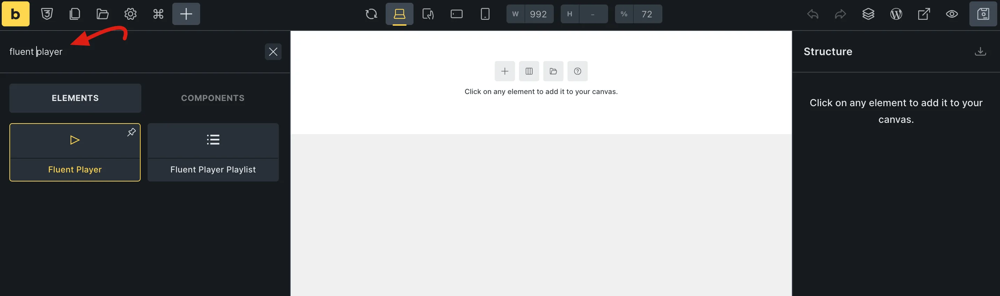
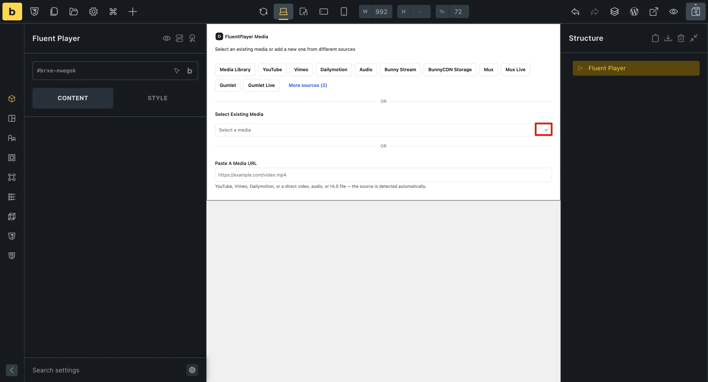
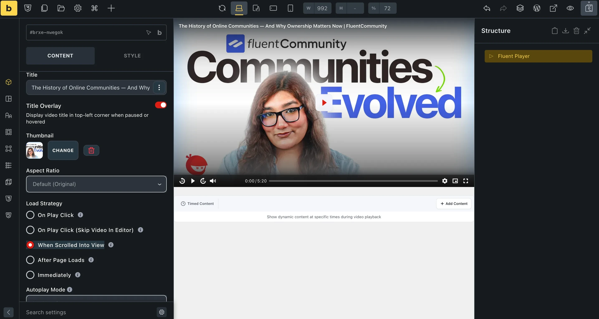
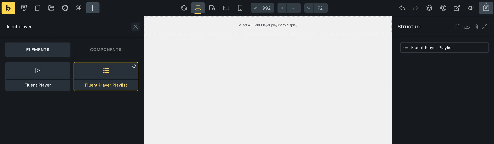
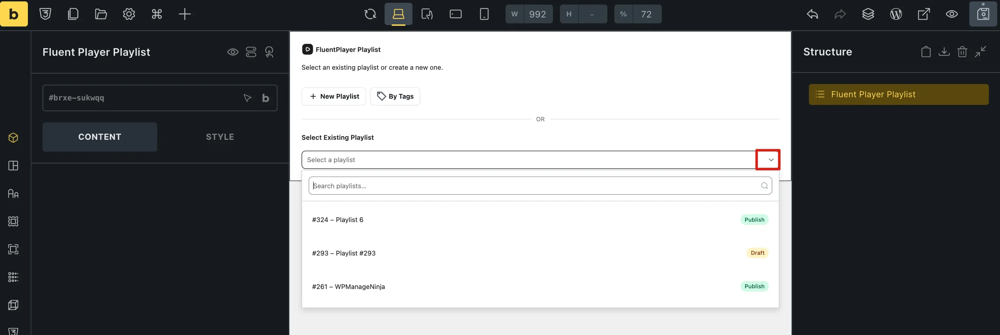
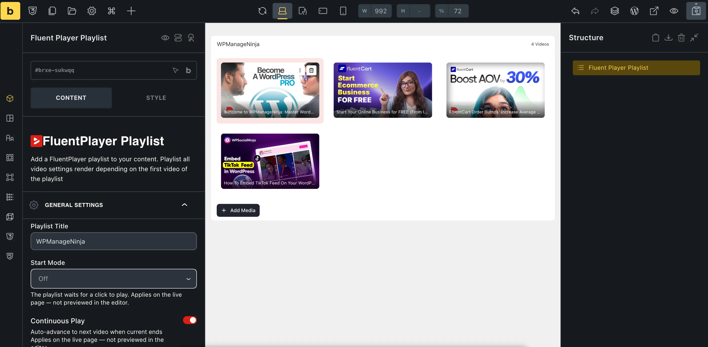

# Bricks Element

FluentPlayer includes a native **Bricks Builder element** for the video player, and FluentPlayer Pro adds a matching element for playlists. Drop them into any Bricks section or container, pick your media right on the canvas, and adjust the player settings in the Bricks panel, no shortcode needed.

::: info Free and Pro
The **Fluent Player** element is available in the free plugin. The **Fluent Player Playlist** element requires **FluentPlayer Pro** and only appears in Bricks when Pro is active. [Playlists](/playlists) are a Pro feature.
:::

Both elements appear in the Bricks **Elements** panel under their own **Fluent Player** category.

## Adding the Fluent Player Element

1. Open a page with **Edit with Bricks**.
2. In the **Elements** panel on the left, type **fluent player** in the search box. You can also find the element under the **Fluent Player** category.
3. Drag the **Fluent Player** element onto the canvas, or click it to add it.

4. The element shows a **FluentPlayer Media** picker on the canvas: *"Select an existing media or add a new one from different sources."* You have three choices:
   - **Add new media:** Click a source button (such as **Media Library**, **YouTube**, **Vimeo**, **Dailymotion** or **Audio**) to add a new video right from the canvas.
   - **Select Existing Media:** Open the dropdown, then search for and pick a media item you have already created.
   - **Paste A Media URL:** Paste a YouTube, Vimeo, Dailymotion, or direct video, audio, or HLS link. FluentPlayer detects the source automatically.

5. Once you pick or add media, the player renders live on the canvas. The player settings panels appear in the Bricks panel on the left, starting with **General Settings**.
6. Click **Save** in the Bricks toolbar to save your page.

::: tip Settings belong to the media
Changes you make in the Bricks panel are saved to the media item itself, just like in the [Gutenberg Block](/block). If you embed the same media on several pages, they all use the same settings.
:::

If you use **Timed Content (Pro)**, its editor appears below the player on the canvas, so you can add content sections for each time range without leaving Bricks. See [Timed Content Area](/timed-content).

## Adding the Fluent Player Playlist Element (Pro)

1. In the **Elements** panel, type **fluent player** in the search box.
2. Drag the **Fluent Player Playlist** element onto the canvas, or click it to add it. Until you choose a playlist, the canvas shows *"Select a Fluent Player playlist to display."*

3. With the element selected, a **FluentPlayer Playlist** picker appears on the canvas: *"Select an existing playlist or create a new one."* You can:
   - **Select Existing Playlist:** Open the dropdown, then search for and pick a playlist.
   - **New Playlist:** Create a new playlist. Enter a **Playlist Title** and click **Create Playlist**.
   - **By Tags:** Build a [tag-based playlist](/tag-based-playlists). Choose one or more tags, and media with those tags appears in the playlist automatically.

4. Once selected, the playlist renders live on the canvas. The playlist settings appear in the Bricks panel, starting with **General Settings** (**Playlist Title**, **Start Mode**, **Continuous Play** and more).
5. Click **Save** in the Bricks toolbar to save your page.

For what each playlist option does, see [Playlist Layouts](/playlist-layouts) and [Appearance & Behavior](/playlist-settings).

## Available Settings

The Fluent Player element uses the same settings panels as the [Gutenberg Block](/block-editor):

| Panel | What you can configure |
|-------|----------------------|
| **General Settings** | Title, title overlay, thumbnail, aspect ratio, load strategy, autoplay |
| **Preset** | The player preset for this media |
| **Branding** | Logo, colors, player skin overrides |
| **Interactive Layers** | Email capture, CTA, Hotspots, Fluent Forms, Ads |
| **Chapters** | Chapter markers and titles |
| **Timestamp Links** | Clickable links that jump to a time in the video |
| **Subtitles** | Subtitle tracks and caption styling |
| **Multi-Language** | Audio language tracks |
| **Tags (Pro)** | [Media tags](/media-tags) |
| **Text/Button Overlays (Pro)** | Text and button overlays |
| **Timed Content Area (Pro)** | Content blocks that appear below the player at exact timestamps |

