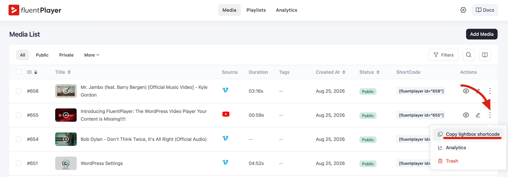
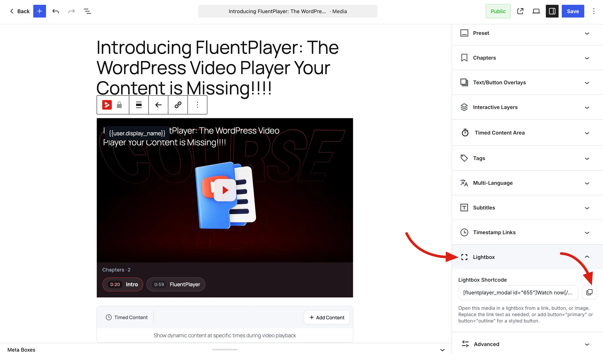
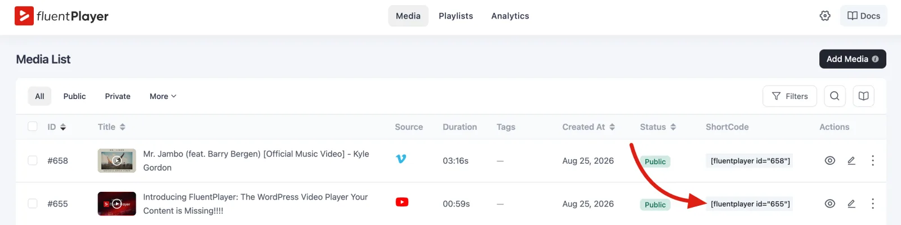
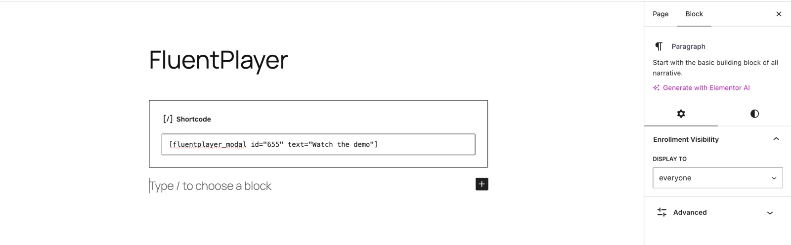
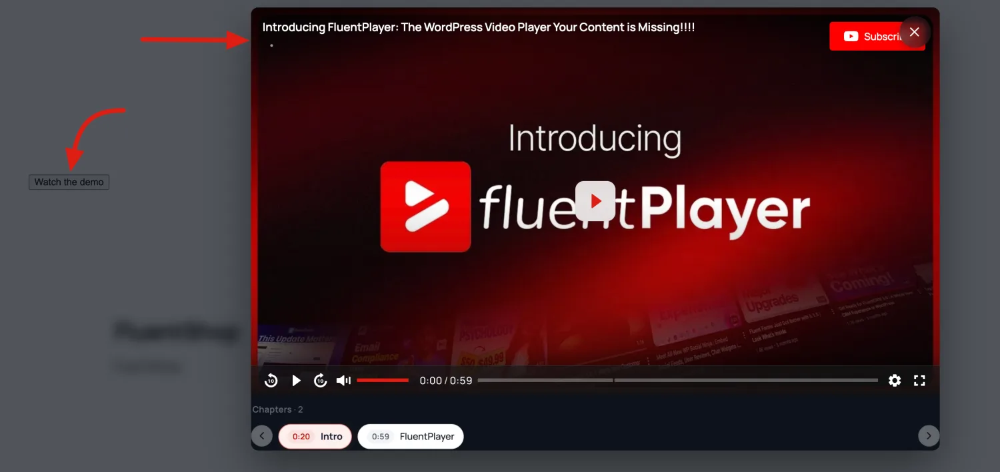

# Lightbox Embed (Pro)

A **lightbox** (or modal) embed keeps the video off the page until someone asks for it. Instead of a player sitting in your layout, you show a button, a link, or a thumbnail — and the video opens in a popup over the page when it's clicked.

This is useful when you want a clean landing page, a "Watch the demo" button in a hero section, or a video that shouldn't compete with the rest of your content.

::: info Pro feature
The lightbox shortcode requires **FluentPlayer Pro**. In the free version, use the [shortcode](/shortcode) or [Gutenberg block](/block) to place a player directly on the page.
:::

You can add a lightbox with the `[fluentplayer_modal]` shortcode, as shown below, or with the **FluentPlayer Lightbox** block. See [Add a Lightbox with the Block](#add-a-lightbox-with-the-block-pro).

## Add a Lightbox in Three Steps

### Step 1: Copy the lightbox shortcode

You don't have to write the shortcode yourself. FluentPlayer generates it for the media you're looking at, and there are **two places to copy it from**. Both give you exactly the same thing:

```text
[fluentplayer_modal id="655"]Watch now[/fluentplayer_modal]
```

**From the Media list.** Go to **FluentPlayer → Media**, open the **⋮** menu at the end of the video's row, and choose **Copy lightbox shortcode**.



**From the Player Editor.** Open the media, and in the **Block** tab expand the **Lightbox** panel. The **Lightbox Shortcode** field holds the ready-made shortcode, with a copy button beside it.



Use whichever is closer to hand — the Media list when you're picking a video out of your library, the Player Editor when you're already editing one.

::: tip Replace the label
What you copy uses **Watch now** as the trigger text. Swap it for your own wording, or replace it with an image — see [Using a Thumbnail or Custom Trigger](#using-a-thumbnail-or-custom-trigger).
:::

**Building it by hand.** The lightbox uses the **same ID** as the regular shortcode, so you're only swapping the shortcode name. The Media list shows each video's ID at the start of its row (like `#655`) and its regular shortcode in the **ShortCode** column, so `[fluentplayer id="655"]` becomes `[fluentplayer_modal id="655"]`.



### Step 2: Add the shortcode to your page

Edit the page where you want the video, add a **Shortcode** block, and paste your lightbox shortcode into it:

```text
[fluentplayer_modal id="655" text="Watch the demo"]
```



The `text` attribute is the label people will click. Update the page when you're done.

### Step 3: Check it on the front end

Visit the page. You'll see your trigger where the shortcode was — and clicking it opens the video in a lightbox over the page.



The rest of the page dims behind the video, and viewers close the lightbox with the **✕** in the top corner, by clicking outside it, or by pressing <kbd>Esc</kbd>.

::: tip Your player features come along
The lightbox shows the same player you'd get inline — the same preset, branding, and controls. Chapters, subtitles, and overlays all work inside it, as the [chapter strip](/chapters#chapters-display) below the video in the screenshot shows.
:::

No player is loaded on the page until the visitor clicks, so a lightbox embed does not slow down the initial page load.

::: warning The default trigger is deliberately plain
With no `button` attribute, the trigger renders as an unstyled button that inherits whatever your theme does — which can look very bare, as in the screenshot above. For anything meant to be a real call to action, add `button="primary"` or `button="outline"`. See [Button styles](#button-styles).
:::

## Using a Thumbnail or Custom Trigger

A text label isn't your only option. A video thumbnail with a play icon usually gets more clicks than a plain button, and the shortcode supports that through a second form.

**Self-closing** — what you used above. FluentPlayer builds the trigger from the `text` attribute:

```text
[fluentplayer_modal id="655" text="Watch the demo"]
```

**Enclosing** — you supply whatever the visitor should click:

```text
[fluentplayer_modal id="655"]Watch the demo[/fluentplayer_modal]
```

The enclosing form is the one to use when you want a thumbnail, an icon, or styled text as the trigger:

```text
[fluentplayer_modal id="655"]
  
[/fluentplayer_modal]
```

If you use neither `text` nor enclosed content, the trigger falls back to the label **Play video**.

::: tip What you can put inside
Basic presentational HTML works inside the enclosing form — images, icons, and simple text formatting. Links and form fields are removed, because the trigger is itself a button and nesting a link inside it would break keyboard and screen-reader behavior.
:::

## Shortcode Attributes

| Attribute | Required | Default | Description |
|-----------|----------|---------|-------------|
| `id` | Yes | — | The media (post) ID to open in the lightbox. |
| `text` | No | *empty* | The trigger label. Used only in the self-closing form — enclosed content wins if both are present. |
| `button` | No | `plain` | Trigger style: `plain`, `primary`, or `outline`. See below. |
| `class` | No | *empty* | Extra CSS classes on the trigger, for your own styling. |
| `size` | No | `medium` | How wide the lightbox opens: `small` (up to 640px), `medium` (up to 960px), `large` (up to 1280px), or `full` (fills the screen width). |
| `autoplay` | No | *media setting* | `yes` starts the video as soon as the lightbox opens; `no` waits for the viewer to press play. Leave it out to use the video's own autoplay setting. |
| `close_on_backdrop` | No | `yes` | `no` keeps the lightbox open when the viewer clicks outside it. The **✕** button and <kbd>Esc</kbd> always close it. |
| `group` | No | *empty* | A group name. Lightboxes on the same page with the same group name get previous and next arrows, so viewers can move between them like a gallery. |

For `autoplay` and `close_on_backdrop`, FluentPlayer also accepts `1`, `true`, and `on` as "yes". Any other value counts as "no".

```text
[fluentplayer_modal id="655" text="Watch the tour" button="primary" size="large" autoplay="yes" group="product-tour"]
[fluentplayer_modal id="656" text="Part two" button="primary" size="large" autoplay="yes" group="product-tour"]
```

### Button styles

| Value | Result |
|-------|--------|
| `plain` | No FluentPlayer styling. The trigger inherits your theme's appearance — best when you're supplying a thumbnail or want the link to match surrounding text. |
| `primary` | A solid button in FluentPlayer's brand color. |
| `outline` | A bordered button with a transparent background. |

```text
[fluentplayer_modal id="655" text="Watch the demo" button="primary"]
[fluentplayer_modal id="655" text="See how it works" button="outline" class="my-hero-cta"]
```

## Add a Lightbox with the Block (Pro)

If you build pages in the block editor, you don't need the shortcode. The **FluentPlayer Lightbox** block opens a video in a lightbox from a button, a text link, a thumbnail, or any blocks you design yourself.

::: info Pro feature
The block is available to add in the free version, but it shows the notice "Lightbox is a Pro feature. The trigger is hidden on your site until FluentPlayer Pro is active." Without **FluentPlayer Pro**, the block shows nothing on your live site.
:::

### Add the block

1. Edit your page and click the **+** block inserter.
2. Search for **FluentPlayer Lightbox** (or type "lightbox" or "popup") and add it.
3. Pick the video to open from the media list. You can search by title.
4. In the **Trigger** panel of the right sidebar, choose a trigger: **Button**, **Thumbnail**, **Text link**, or **Custom**.
5. Adjust the settings in the right sidebar, then save or update the page.

<!-- SCREENSHOT: /docs/public/display-embed/lightbox/lightbox-block-6.webp — the FluentPlayer Lightbox block placeholder with the media picker, and the Trigger panel showing the four trigger choices -->

### Trigger types

| Trigger | What visitors click |
|---------|---------------------|
| **Button** | A styled call-to-action button. |
| **Thumbnail** | A poster image with a play icon. |
| **Text link** | An inline link inside your text. |
| **Custom** | Any blocks you build, such as an image, a heading, or a card. Clicking anywhere on it opens the lightbox. |

For a **Custom** trigger, add your own blocks inside the Lightbox block. If you leave it empty, nothing shows on the page.

### Block settings

The block sidebar has three panels.

**Media** — choose or change the video the lightbox opens. If the video was deleted, the panel shows "Could not load this media. It may have been deleted."

**Trigger** — the settings here change with the trigger type.

| Setting | Trigger | What it does |
|---------|---------|-------------|
| **Label** | Button, Text link | The text visitors click. Leave it empty to use **Watch now**. |
| **Button style** | Button | **Filled** and **Outline** use the video's brand color. **Theme** uses your theme's button styling. |
| **Show play icon** | Button, Text link | Shows a small play icon before the label. On by default. |
| **Choose image** | Thumbnail | Uses your own image instead of the video's poster. Click **Use media poster** to go back to the poster. |
| **Aspect ratio** | Thumbnail | The thumbnail shape: **16:9**, **21:9**, **4:3**, **1:1**, or **9:16**. Default is **16:9**. |
| **Show caption** | Thumbnail | Shows a caption on the thumbnail. On by default. |
| **Caption** | Thumbnail | The caption text. Leave it empty to use the video's title. |
| **Show duration** | Thumbnail | Shows the video's length on the thumbnail. On by default. The badge appears only once the video has a recorded duration. |

For **Button** and **Text link** triggers, you can also set the alignment (left, center, or right) from the block toolbar.

**Lightbox** — how the lightbox itself behaves.

| Setting | Default | What it does |
|---------|---------|-------------|
| **Size** | **Medium** | **Small** (up to 640px wide), **Medium** (up to 960px), **Large** (up to 1280px), or **Full** (fills the screen width). |
| **Start playing when opened** | On | Starts the video as soon as the lightbox opens. If the browser blocks sound, the video plays muted. |
| **Close when clicking outside** | On | Closes the lightbox when the visitor clicks the dimmed page behind it. The close button and <kbd>Esc</kbd> always work. |
| **Gallery group** | *empty* | Give several lightboxes on the same page the same group name (for example `product-tour`) to add previous and next arrows between them. |
| **Share link** | — | A link that opens the page with this lightbox already open. Click **Copy link** to copy it. See [Share a link that opens the lightbox](#share-a-link-that-opens-the-lightbox). |

<!-- SCREENSHOT: /docs/public/display-embed/lightbox/lightbox-block-settings-7.webp — the block sidebar showing the Media, Trigger and Lightbox panels for a Thumbnail trigger -->

::: tip Gallery groups work across both
A Lightbox block and a `[fluentplayer_modal]` shortcode with the same group name on the same page belong to the same gallery.
:::

### Preview the lightbox

Click **Preview** in the block toolbar to see how the player looks inside the lightbox without leaving the editor. Preview plays are not counted in analytics.

<!-- SCREENSHOT: /docs/public/display-embed/lightbox/lightbox-preview-8.webp — the Lightbox preview window open in the block editor -->

## Share a Link That Opens the Lightbox

You can send people a link that opens your page with the lightbox already open. This is handy for emails, social posts, or links from other pages.

Add `#fp-lightbox-` and the media ID to the end of the page address:

```text
https://example.com/demo-page/#fp-lightbox-655
```

The Lightbox block builds this link for you in the **Share link** field of its **Lightbox** panel. The page you link to must contain a lightbox (block or shortcode) for that video.

## Lightbox Analytics (Pro)

When [built-in analytics](/built-in-analytics) is turned on, FluentPlayer Pro counts how people use your lightboxes. Open a video's analytics page (for example, by clicking it in **Top Media** on the **Analytics** dashboard) to see two extra cards:

- **Lightbox Opens**: how many times a lightbox opened this video in the selected date range, with the change from the previous period.
- **Watched from Lightbox**: the share of those opens where the viewer actually watched the video (a few seconds of playback) in the lightbox.

These cards appear only after the video has been opened in a lightbox at least once in the selected date range. Both the Lightbox block and the `[fluentplayer_modal]` shortcode are tracked.

<!-- SCREENSHOT: /docs/public/display-embed/lightbox/lightbox-analytics-9.webp — a video's analytics page with the Lightbox Opens and Watched from Lightbox cards -->

## Private and Password-Protected Videos

The lightbox respects your [visibility settings](/public-vs-private) exactly as an inline player does:

- A **private** video opens in the lightbox for people allowed to see it, and the shortcode renders nothing for everyone else.
- A **password-protected** video asks for the password inside the lightbox before it plays.

There is no way to reach a video through the lightbox that a visitor couldn't already watch on the page.

## Accessibility

The trigger renders as a real `<button>`, not a styled link, so it is reachable by keyboard, announced correctly by screen readers, and works with browser zoom and high-contrast modes without extra work from you.

If you supply an image as the trigger, give it meaningful `alt` text — that text is what a screen-reader user hears.
