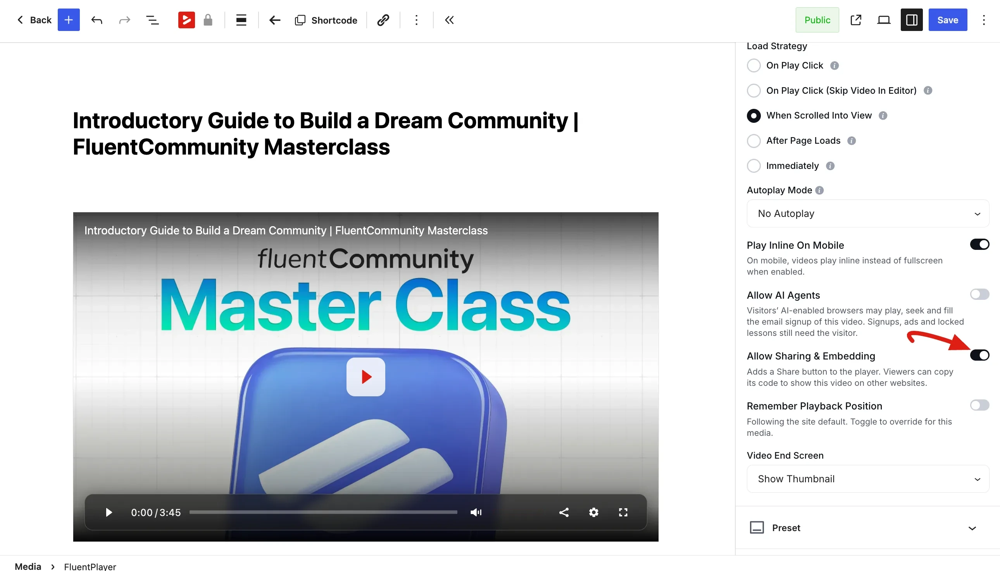
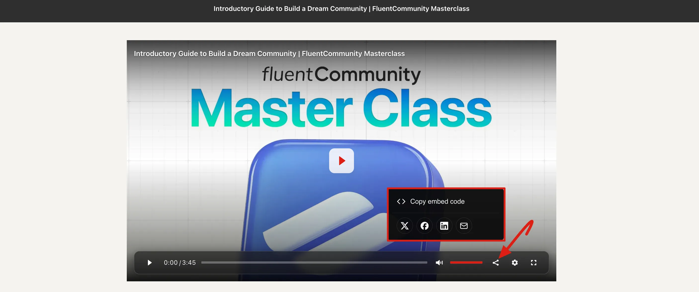
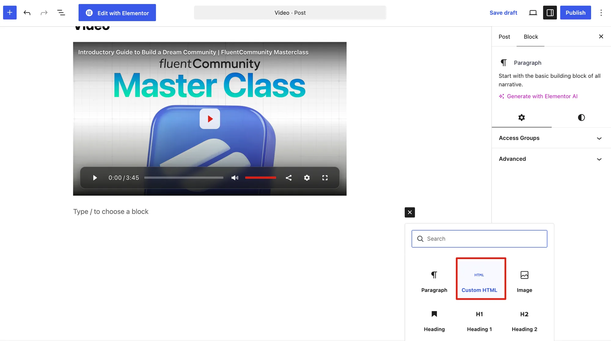
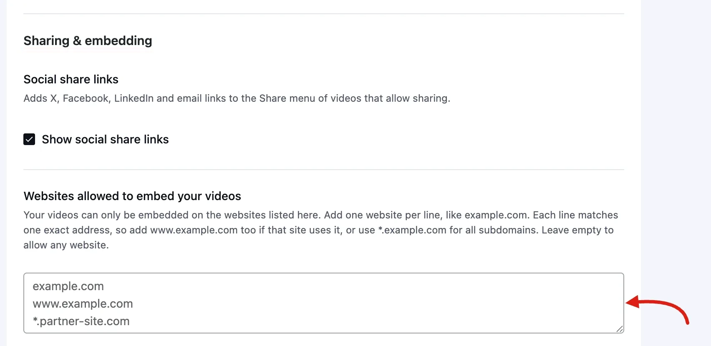
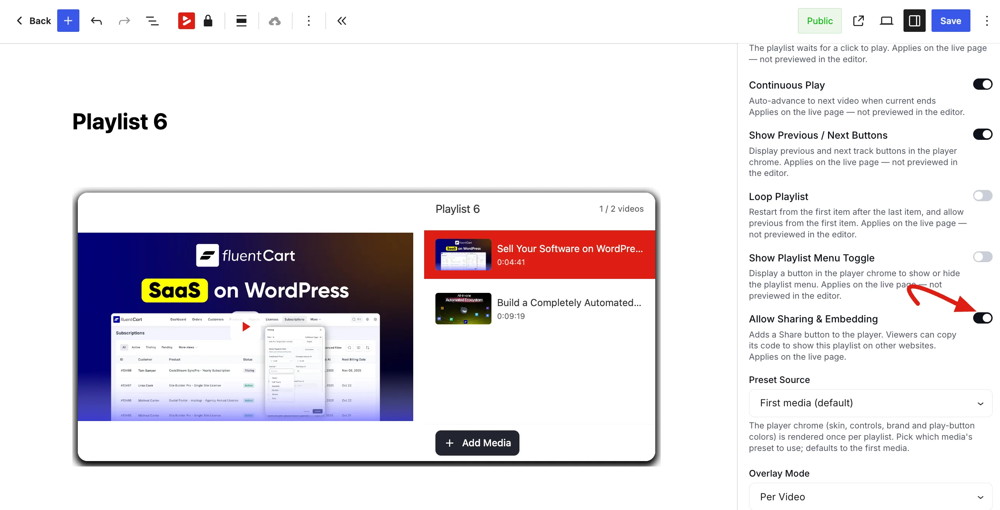

# Sharing & Embedding

FluentPlayer can add a **Share** button to your player. Viewers use it to copy an embed code and show your video on their own website, or to share the video on social media.

Sharing and embedding videos is free. [FluentPlayer Pro](#limit-which-websites-can-embed-your-videos-pro) lets you choose which websites are allowed to embed your videos, and adds sharing for playlists.

## Turn On Sharing for a Video

Sharing is switched on one video at a time. It is **off** by default, so nothing changes until you turn it on.

1. Go to **FluentPlayer → Media** and open the video.
2. In the right-hand sidebar, open the **Block** tab and expand [General Settings](/general-settings).
3. Switch on **Allow Sharing & Embedding** — *"Adds a Share button to the player. Viewers can copy its code to show this video on other websites."*
4. Save the media.

::: info When the Share button appears
The Share button only shows on a video that is **published**, **public**, and **not password protected**. A draft, private or password-protected video never shows it, even with the toggle on. See [Public vs Private Visibility](/public-vs-private).
:::

## What Viewers See

Once sharing is on, a **Share** button appears in the player controls. Clicking it opens the Share menu, which offers:

- **Copy embed code** — copies a ready-made code the viewer can paste on another website. The button confirms with **Embed code copied**.
- **Share on X**, **Share on Facebook**, **Share on LinkedIn** and **Share by email** — these open a new tab with the video's link and title filled in. They only show when [social share links](#social-share-links) are on.

If the browser blocks automatic copying, the player shows the code in a box with the message *"Could not copy automatically. Your code is:"* so the viewer can copy it by hand.

## The Embed Code

The embed code shows the video in a frame that points to the video's own embed page on your site. It is sized to a maximum width of 640px and keeps the video's shape on any screen.

::: warning Paste it into a Custom HTML block
The code works on any website that accepts HTML. On a WordPress site, paste it into a **Custom HTML** block.

1. In the block editor, click **+** (or type `/`) where you want the video.
2. Choose **Custom HTML**.
3. Paste the embed code into the block, then save or publish the page.
:::

The video still plays from your site, so your [player settings](/block-editor), branding and visibility rules apply wherever it is embedded. If you later turn off **Allow Sharing & Embedding**, unpublish the video, or make it private, the embedded copies stop playing. They show *"This video can't be embedded."* with a link back to your site instead.

::: tip
The embed page lives at the video's [dedicated URL](/dedicated-player-url) with `/embed/` added to the end. If your site has switched off dedicated media pages (see the [Hooks & Filters Reference](/hooks-reference#media-pages)), sharing is not available.
:::

## Social Share Links

You can show or hide the X, Facebook, LinkedIn and email links for every video on your site at once.

1. Go to **FluentPlayer → Settings** and select **General**.
2. Scroll to the **Sharing & embedding** section.
3. Under **Social share links**, tick or untick **Show social share links** — *"Adds X, Facebook, LinkedIn and email links to the Share menu of videos that allow sharing."*
4. Click **Save Settings**.

This setting is **on** by default. Turning it off keeps the Share button and **Copy embed code**, and only removes the social links.

::: info Link previews on social media
When someone shares a video's link, FluentPlayer adds the video's title, description and poster image to the page, so the post shows a proper preview. On X, the video can even play inside the post. If you use Yoast SEO, Rank Math or All in One SEO, FluentPlayer leaves these preview tags to your SEO plugin.
:::

## Limit Which Websites Can Embed Your Videos (Pro)

By default, a shared video can be embedded on any website. With FluentPlayer Pro, you can allow only the websites you trust.

1. Go to **FluentPlayer → Settings** and select **General**.
2. In the **Sharing & embedding** section, find **Websites allowed to embed your videos**.
3. Add one website per line, for example `example.com`.
4. Click **Save Settings**.

In the free version, this field shows *"Choosing where your videos can be embedded is a Pro feature"* with an upgrade link instead.

### How the list matches websites

- **Each line matches one exact address.** `example.com` does not cover `www.example.com`. If a site uses `www`, add that line too.
- **Use `*.example.com` for all subdomains**, such as `blog.example.com` and `shop.example.com`. Add `example.com` as well if the main address also needs access.
- **You can add a full address** such as `https://example.com` or one with a port, like `https://example.com:8443`. Anything after the address (a page path) is ignored.
- **Leave the list empty to allow any website.**

If an entry is not a valid website address, FluentPlayer does not save the list. It names the entries to fix instead: *"These embed domains are not valid: …"*.

::: tip Always allowed
Your own site can always show your videos, so you don't need to add it. X is also always allowed, so a shared video can still play inside a post on X.
:::

The list applies to every shared video and every shared playlist on your site. On a website that is not on the list, the browser refuses to load the embedded video.

## Sharing and Embedding Playlists (Pro)

[Playlists](/playlists) can be shared the same way, so other websites can embed the whole playlist.

1. Go to **FluentPlayer → Playlists** and open the playlist.
2. In the **Block** tab, find the playlist's behavior settings (see [Playlist Settings](/playlist-settings)).
3. Switch on **Allow Sharing & Embedding** — *"Adds a Share button to the player. Viewers can copy its code to show this playlist on other websites. Applies on the live page."*
4. Save the playlist.

The Share menu then works just like it does for a single video. The embed code shows the whole playlist, and the **Show social share links** and **Websites allowed to embed your videos** settings apply to it too. On social media, the playlist's preview uses the poster image of its first video.

::: info Which playlists can be shared
Only saved playlists that are **published** and **not password protected** can be shared. The toggle does not appear for [tag-based playlists](/tag-based-playlists). The Share button shows on the live page, not in the editor preview.
:::

