# BunnyCDN Storage (Pro)

**BunnyCDN Storage** (Edge Storage) allows you to host your video files on Bunny.net’s global infrastructure instead of your own WordPress server. This is an ideal solution for self hosted videos, as it offloads the storage and bandwidth burden, ensuring your site remains fast while providing a high performance playback experience for your viewers.

::: info Pro feature
BunnyCDN Storage integration requires **FluentPlayer Pro**.
:::

## When to Use Bunny Storage

- You already have **pre encoded video files** (for example, MP4 files in the right quality).
- You want **simple, cheap file hosting** with CDN delivery.
- You do not need automatic encoding into multiple quality levels.

For most users, [Bunny Stream](/bunnycdn-stream) is the better choice because it handles encoding automatically. Use Bunny Storage when you have specific files you want to host as is.

## How to Connect BunnyCDN Storage

To integrate your Bunny storage zones with FluentPlayer, follow these steps:

### 1. Get Credentials from BunnyCDN

First, log into your [Bunny account](https://dash.bunny.net/auth/login?pk_buttonlocation=menu), then go to **Storage** from the left sidebar and click on **Add Storage Zone**.

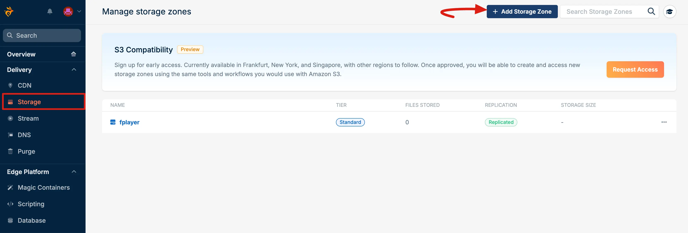

A popup will appear to set up the **Storage Zone** settings. Now choose your preferred **Storage Tier** (Standard). Then, select the **Main Storage Region** based on your users’ location. Finally, click on the **Add Storage Zone** button.

>[!Note]
>Keep track of the Main Storage Region you select, as you’ll need this information later when configuring BunnyCDN with FluentPlayer.

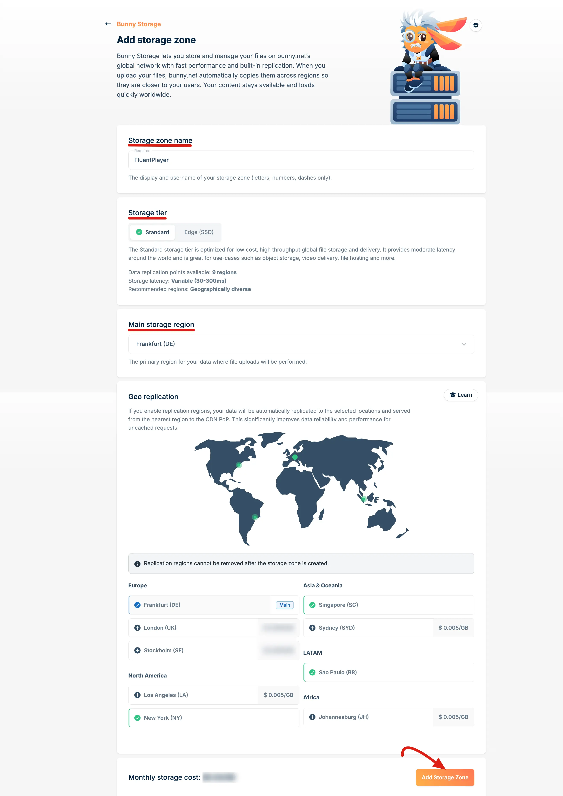

#### Connect Pull Zone

Go to the **Storage Zone** you just created, then select **Connected Pull Zones** from the left sidebar and click on the **+ Connected Pull Zone** button.

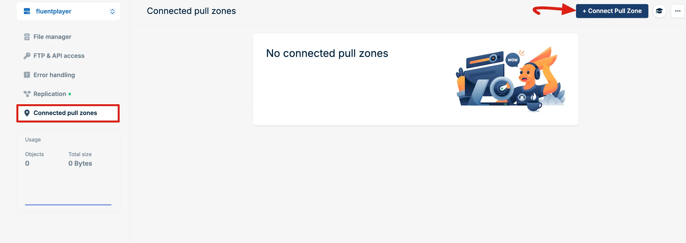

A **Pull Zone** setup popup will appear. Start by entering a **name** for your Pull Zone. Then, set the **Origin Type** to **Storage Zone** and select your created **Storage Zone** from the dropdown.

Next, choose a **Tier** based on your needs. Once everything is set, click **Add Pull Zone** to save your configuration.

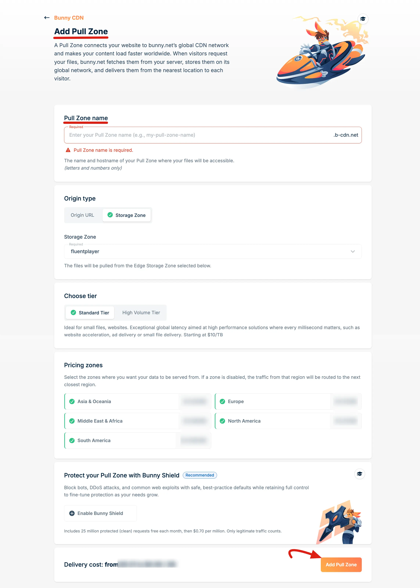

You will now see your **Pull Zone Hostname**. **Enable** the **Linked hostnames** and **copy** this hostname and keep it for later use. This hostname is your **BunnyCDN public URL**, which you will need to enter in the FluentPlayer Bunny configuration settings.

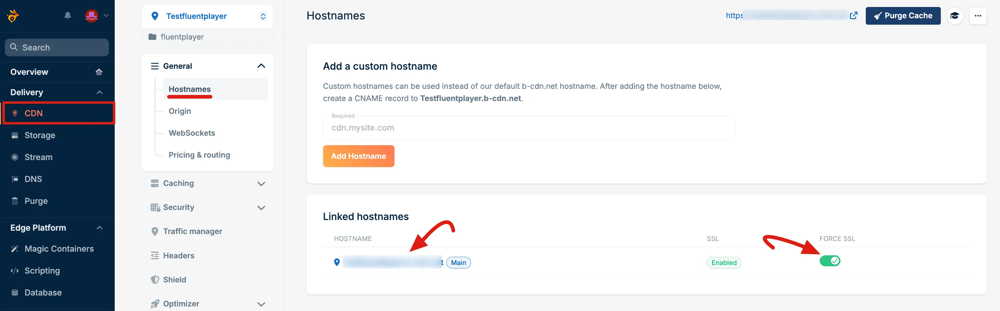

#### Authentication Key

Go to the **Token authentication** under the **Security**. Now, copy the **Url token authentication key** for FluentPlayer settings storage use.

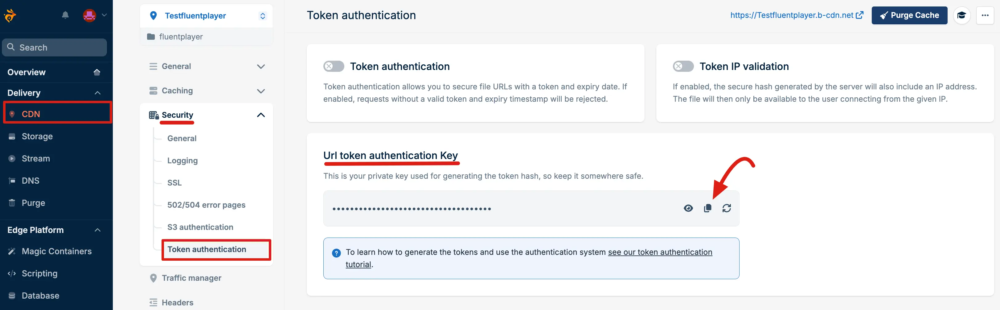

#### API & Credentials

Go to the Storage Zone you created and open the **FTP & API Access** tab from the left sidebar. Here, you will find your **Username** and **Password**. **Copy** both for later use.

>[!Note]
>The Username is your BunnyCDN Storage Zone name and the Password is your BunnyCDN API key.

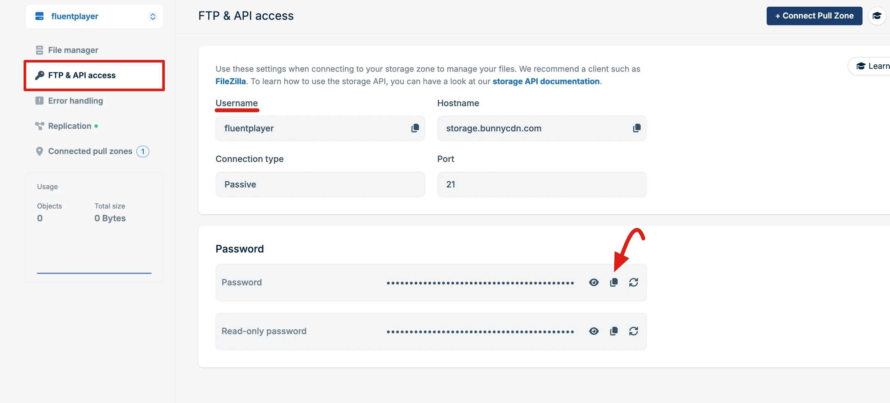

### 2. Configure FluentPlayer Settings

In your WordPress dashboard, navigate to **FluentPlayer → Settings → Storage**.

Under the BunnyCDN Storage section:

- Toggle **Enable Integration** to turn it on.
- Under **Storage Zones**, click **Add Storage Zone** and fill in the details of your zone:
  - **Storage Zone Name**: your BunnyCDN storage zone name (the **Username** from the FTP & API Access tab).
  - **Storage Password**: your storage password / API key (the **Password** from the FTP & API Access tab).
  - **Storage Hostname**: the storage hostname. It is filled in with `storage.bunnycdn.com`. Change it only if your region uses a different one.
  - **CDN Hostname (Pull Zone)**: the pull zone hostname used for video delivery.
  - **CDN Security Key** (optional): your token authentication key, if **token authentication** is enabled.

Finally, click **Save Settings** to connect FluentPlayer with your BunnyCDN storage.

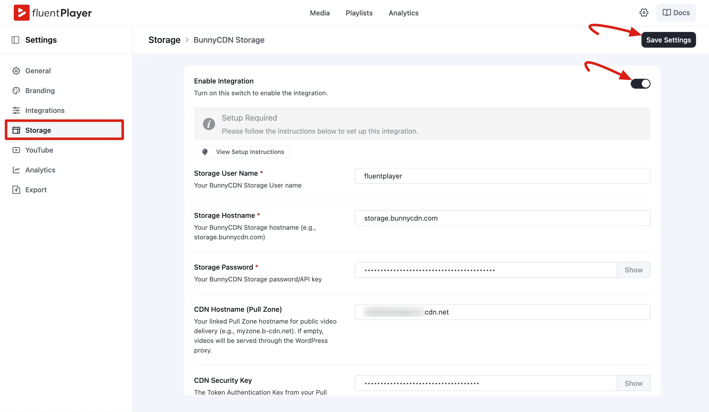

#### Add More Than One Storage Zone

You can connect several Bunny storage zones and use them side by side. For each extra zone:

1. Create the zone (and its pull zone, if you want one) in Bunny, as shown in step 1.
2. In the BunnyCDN Storage settings, click **Add Storage Zone** again.
3. In the **Add Storage Zone** window, enter that zone's **Storage Zone Name**, **Storage Password**, and other details, then click **Add**.

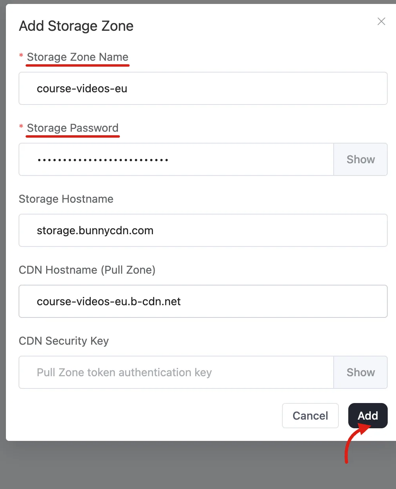

4. The new zone appears in the **Storage Zones** list. Click **Save Settings**.

Each media item remembers which zone its file came from. Your existing videos keep playing from their own zone after you add more.

::: tip Already connected before?
If you set up Bunny Storage on an earlier version, your existing credentials appear as the first entry in **Storage Zones**. You don't need to enter them again.
:::

::: tip No pull zone?
**CDN Hostname (Pull Zone)** and **CDN Security Key** are optional. A zone without a pull zone still works: FluentPlayer serves its files through your WordPress site instead.
:::

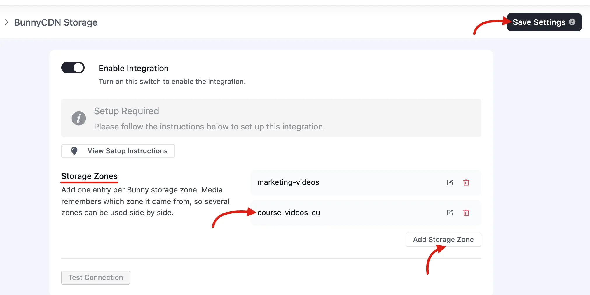

### 3. Adding a Video from Bunny Storage

- Navigate to **FluentPlayer → Media** and click **Add Media**.
- Choose **Bunny Storage** as the source type.

- If you connected more than one storage zone, pick the zone you want to browse from the **Select Storage Zone** dropdown at the top of the file browser. The dropdown only appears when you have two or more zones.

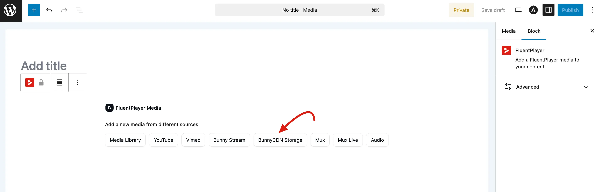

<!-- SCREENSHOT: /docs/public/integrations/bunnycdn-storage/select-storage-zone-15.webp — Bunny Storage file browser with the Select Storage Zone dropdown open, listing two zones -->

#### Managing Files from WordPress

From the Bunny Storage browser inside FluentPlayer you can:

- **List** all files in your storage zone.
- **Upload** new files directly from WordPress.
- **Create folders** to keep large libraries organized.
- **Delete** files from the storage zone.

This lets you manage your hosted files without leaving WordPress.

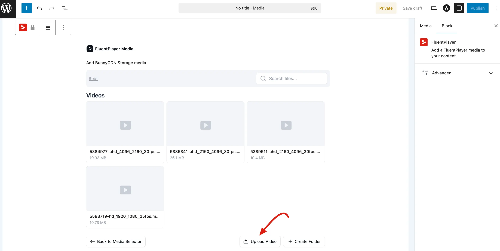

### 4. Adding Audio from Bunny Storage

Bunny Storage supports audio files alongside video. The steps are the same — only the media type changes.

- Navigate to **FluentPlayer → Media** and click **Add Media**.
- Set the media type to **Audio**.
- Choose **Bunny Storage** as the source type.

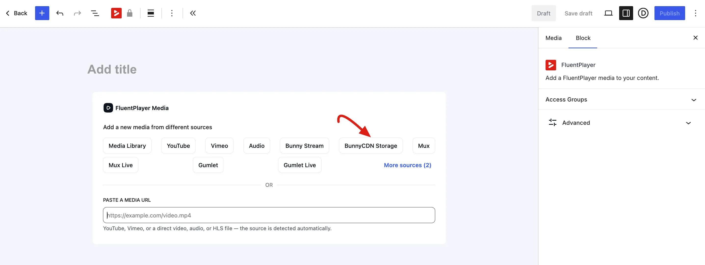

- Browse your storage zone to select an existing audio file, or click **Upload** to send a new file directly from WordPress.
- Save the media item. FluentPlayer switches to the audio-optimized player layout automatically.

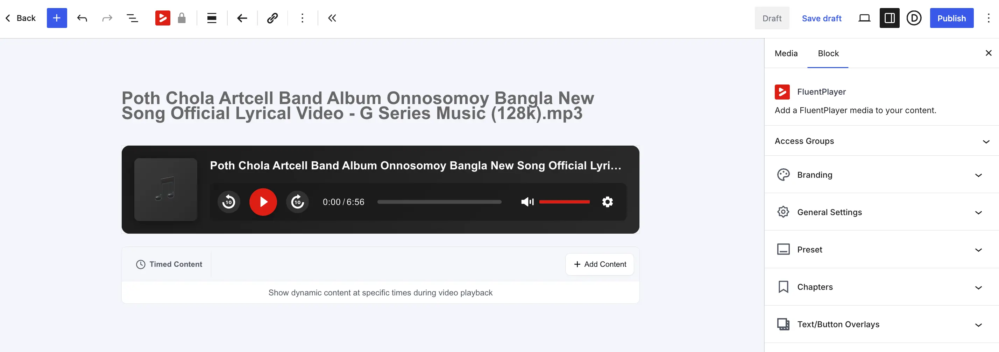

::: tip
You can also paste a direct Bunny Storage audio URL into the **Paste a Media URL** field and FluentPlayer will detect the provider automatically.
:::

## How playback works

When a visitor watches a Bunny Storage video, the player does not always hit your storage zone directly. FluentPlayer can serve the file through a **streaming proxy** endpoint, which fetches the video from your storage zone and streams it to the viewer. This keeps your storage credentials private and lets FluentPlayer apply access control.

If you enabled **token authentication** on your pull zone and entered a **CDN Security Key** during setup, FluentPlayer signs the delivery URLs so they cannot be shared or hotlinked beyond their validity window.

::: tip
Use [Bunny Stream](/bunnycdn-stream) when you want automatic encoding into multiple qualities. Use Bunny **Storage** (this page) when you have ready-to-play files and want simple, secured file delivery through the CDN.
:::

