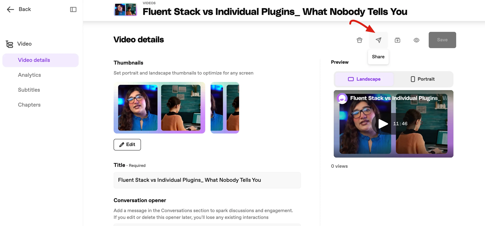
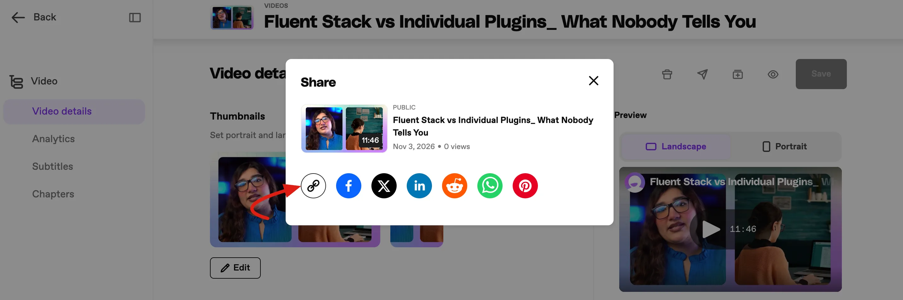
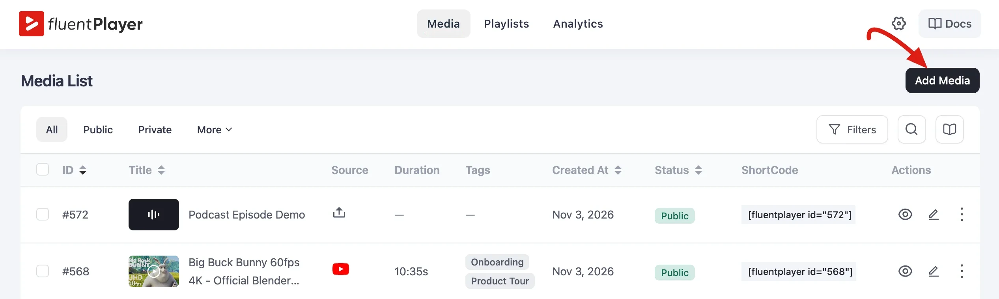
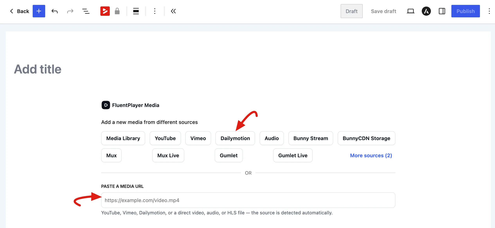
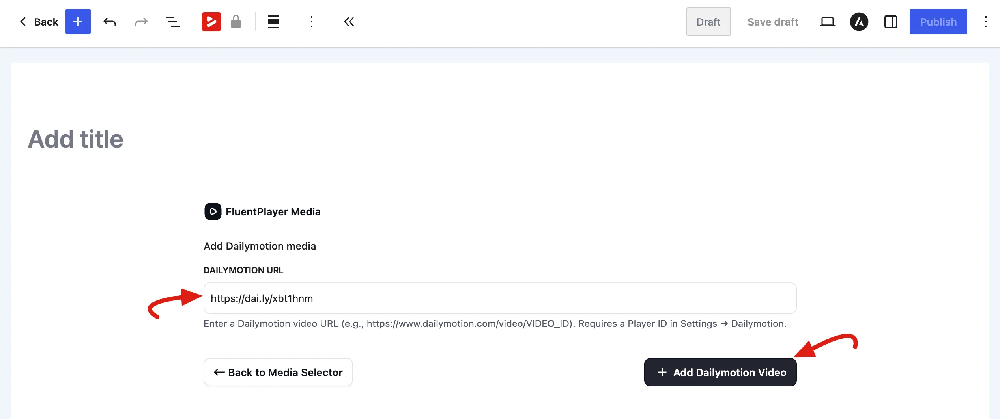
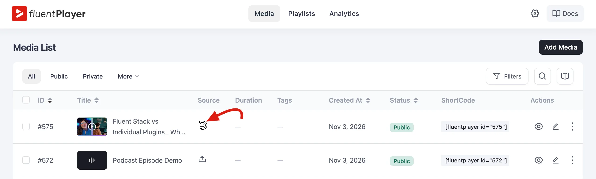
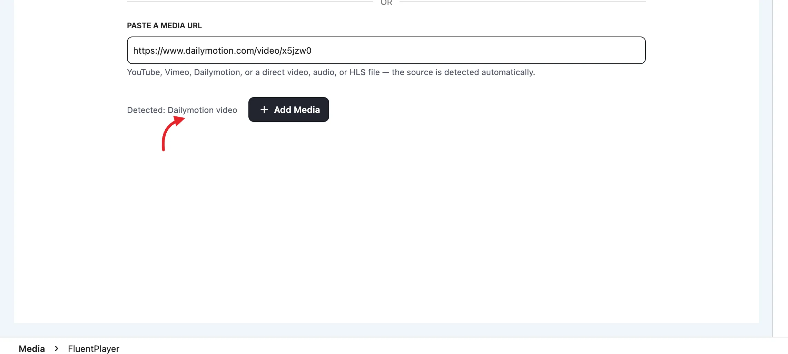
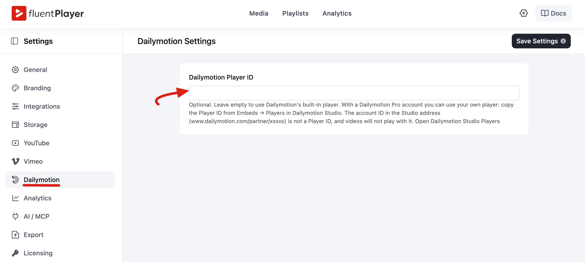

# Dailymotion

**Dailymotion** is a video hosting platform used by creators and publishers. FluentPlayer can play any public Dailymotion video inside your own player, with your FluentPlayer controls, branding, and layers on top. You don't need any embed code.

Playing a Dailymotion video takes two steps: **copy the video URL from Dailymotion, then paste it into FluentPlayer.**

::: info Free feature
Dailymotion is part of the **free** version of FluentPlayer, alongside [WordPress, YouTube, Vimeo, and Audio sources](/video-sources).
:::

## Step 1: Copy the Video URL from Dailymotion

1. Open the video on [Dailymotion](https://www.dailymotion.com/).
2. Click the **Share** button.

3. In the **Share** window, click the link icon to copy the video link. You can also copy the address from your browser's address bar.

FluentPlayer accepts these link formats:

| Format | Example |
|--------|---------|
| Standard video page | `https://www.dailymotion.com/video/x8abc12` |
| Embed link | `https://www.dailymotion.com/embed/video/x8abc12` |
| Short link | `https://dai.ly/x8abc12` |

::: tip Make sure the video is viewable
Your visitors can only watch videos that Dailymotion allows to be embedded. If a video is private or restricted on Dailymotion, it may not play on your site.
:::

## Step 2: Add the Video to FluentPlayer

1. In your WordPress admin, go to **FluentPlayer → Media** and click **Add Media**.

2. Under **Add a new media from different sources**, click **Dailymotion**.

3. Paste the link into the **Dailymotion URL** field, then click **+ Add Dailymotion Video**.

4. Click **Publish** to save the media.

That's it. The video is now in your Media List with the Dailymotion icon in the **Source** column, ready to embed anywhere on your site.

### Or paste the link directly

You can also paste a Dailymotion link into the **Paste a media URL** field on the same screen. FluentPlayer shows **Detected: Dailymotion video**, and you click **Add Media**. The video's title and poster image are filled in from Dailymotion automatically.

## Dailymotion Player ID (Optional)

FluentPlayer plays Dailymotion videos through Dailymotion's own player. You don't need to set anything up: when no Player ID is saved, FluentPlayer uses Dailymotion's built-in player.

If you have a **Dailymotion Pro** account, you can use a player you configured in Dailymotion Studio instead:

1. In Dailymotion Studio, go to **Embeds → Players** and copy your **Player ID**.
2. In WordPress, go to **FluentPlayer → Settings → Dailymotion**.
3. Paste the ID into the **Dailymotion Player ID** field.
4. Click **Save Settings**.

This is a site-wide setting. It applies to every Dailymotion video on your site.

::: warning Use the Player ID, not the account ID
The address of your Studio page (`www.dailymotion.com/partner/xxxxx`) contains your **account ID**. That is not a Player ID, and videos will not play with it. Copy the ID from **Embeds → Players** instead. The settings page has an **Open Dailymotion Studio Players** link that takes you there.
:::

## What Works with Dailymotion Videos

Dailymotion videos use FluentPlayer's controls, not Dailymotion's. Your viewers can:

- Play and pause
- Seek along the progress bar
- Change the volume or mute
- Change the **Playback Speed**

Everything that sits on top of the player also works, such as your [preset](/preset), [branding](/branding-appearance), and [interactive layers](/interactive-layers).

::: info What Dailymotion doesn't provide
Unlike [Vimeo](/vimeo), there is no option to import chapters or captions from Dailymotion. You can still add your own [chapters](/chapters) and [subtitles](/block-subtitles) by hand.
:::

## Troubleshooting

**The player shows "Unsupported Dailymotion link".**
FluentPlayer couldn't find a video ID in the link. Copy the link again from the video's own page and make sure it matches one of the [formats above](#step-1-copy-the-video-url-from-dailymotion).

**The video doesn't load at all.**
If you saved a **Dailymotion Player ID**, check that it is the Player ID from **Embeds → Players** and not your account ID. To test, clear the field, save, and reload the page. FluentPlayer then falls back to Dailymotion's built-in player.

