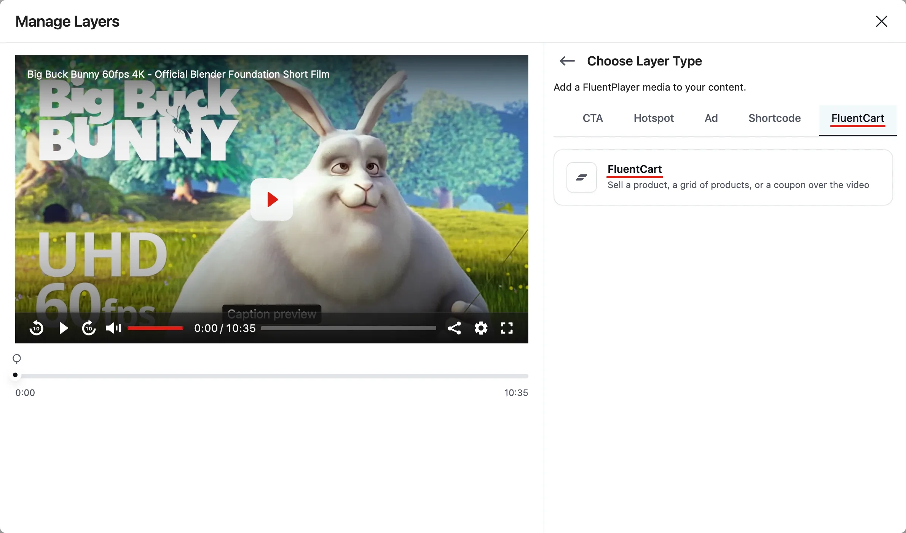
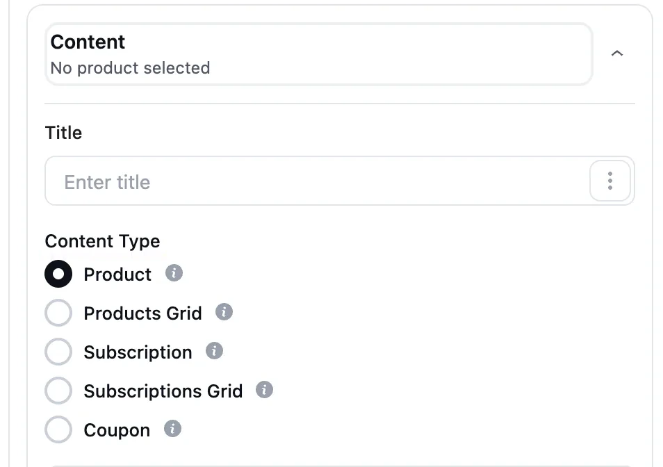
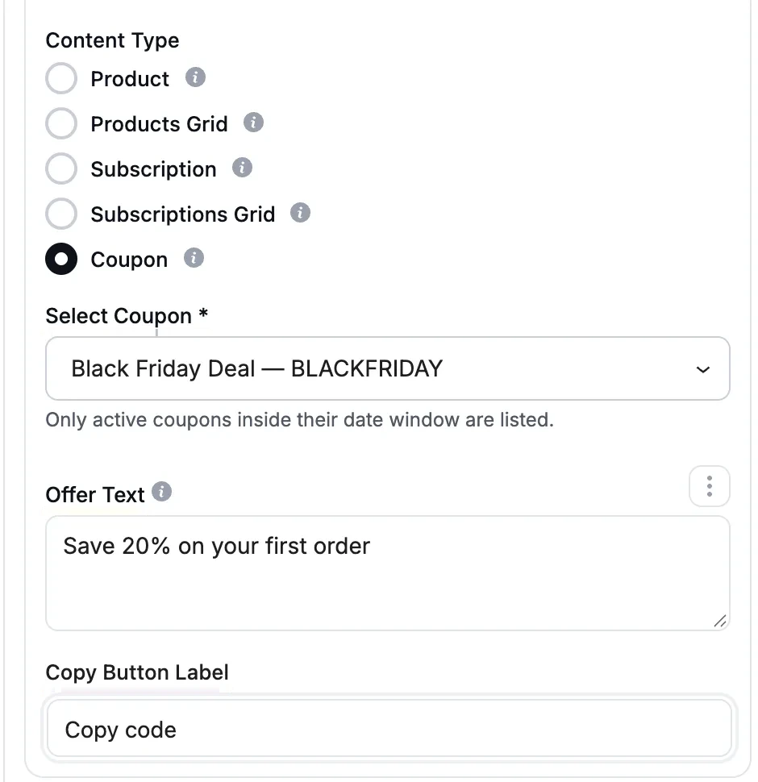
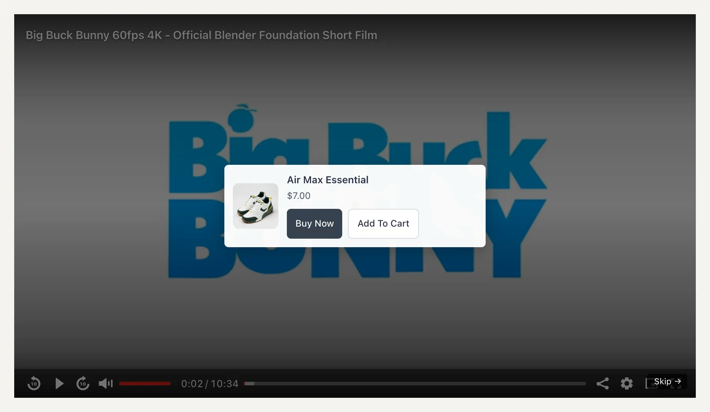

# FluentCart

The **FluentCart** layer allows you to sell from inside your video. At the moment you choose, a product card, a subscription offer, a grid of products, or a coupon code appears over the player, so viewers can buy without leaving the page.

::: info Free and Pro
The FluentCart layer is **free** for single **Product** and **Subscription** cards. **Products Grid**, **Subscriptions Grid**, and **Coupon** need **FluentPlayer Pro**.
:::

## What You Can Do

- **Sell one product**: Show a product card with **Buy Now** and **Add To Cart** buttons at a set time in the video.
- **Offer a subscription**: Show one subscription plan with a **Buy Now** button.
- **Show a grid of products (Pro)**: Show several products or subscription plans side by side. Viewers page through them.
- **Share a coupon (Pro)**: Show a discount code with a one-click **Copy Code** button.

## Requirements

Make sure the following are in place:

- **FluentPlayer** is installed and active.
- **FluentCart** is installed and active on the same site.
- You have at least one **published** product in FluentCart. For a subscription offer, the product needs at least one subscription variation.
- For a coupon, you have an **active** coupon in FluentCart.

::: tip
If FluentCart is not active, the **FluentCart** layer is greyed out in the layer list. Its settings show the message *"FluentCart is not active. Please install and activate it to sell products from your videos."* with an **Install FluentCart** button.
:::

## Step 1: Add the Layer

1. Open your video in the editor and select the **FluentPlayer** block.
2. In the **Block** tab, open the **Interactive Layers** panel.
3. Click **+ Add Layer** to open the **Manage Layers** window.
4. Click the **FluentCart** filter, or find **FluentCart** under **All**, and select it.

The layer settings open with five sections: **Display**, **Content**, **Layout**, **Controls**, and **Appearance**.

## Step 2: Set the Timing

In the **Display** section:

| Setting | What it does |
|---------|--------------|
| **Start Time** | The hour, minute, and second when the offer appears. |
| **Layer Duration (seconds)** | How long the offer stays on screen. **0** (the default) keeps it up until the viewer acts on it. |

## Step 3: Choose the Offer

In the **Content** section, you can add an optional **Title**. Then pick a **Content Type**:

| Content Type | What it shows |
|--------------|---------------|
| **Product** | One product card with **Buy Now** and **Add To Cart**. |
| **Products Grid (Pro)** | Several products in a paged grid, each with its own buttons. |
| **Subscription** | One subscription card. The picker lists only subscription plans. |
| **Subscriptions Grid (Pro)** | Several subscription plans in a paged grid. |
| **Coupon (Pro)** | A discount code with a one-click copy button. |

Without Pro, the grid and coupon options read **(Pro)** and you can't select them.

### Product and Subscription

1. In **Select Product** (or **Select Subscription**), pick the item you want to sell. Only published FluentCart products are listed.
2. If the product has more than one variation, choose one under **Variation**. This decides which variation the buttons add or check out. Leave it on **First variation** to use the first one.
3. Choose which buttons to show:
   - **Buy Now Button** — opens checkout in a new tab, so the video keeps playing. Change its text in **Buy Now Label**.
   - **Add to Cart Button** — adds the product to the cart in place, without leaving the page. Change its text in **Add to Cart Label**.

Both buttons are on by default. You must keep at least one of them on.

::: info Subscriptions only use Buy Now
A subscription is checked out, not added to a cart. For **Subscription** and **Subscriptions Grid**, only the **Buy Now** button appears.
:::

The card shows the price of the variation the buttons sell.

### Products Grid and Subscriptions Grid (Pro)

1. In **Select Products** (or **Select Subscription**), pick the items for the grid. You can add up to **12**.
2. Each card in the grid gets its own buttons, set the same way as for a single product.
3. Choose the grid shape in the **Layout** section (see [Step 4](#step-4-size-and-position)).

### Coupon (Pro)

1. In **Select Coupon**, pick a coupon. Only active coupons inside their date window are listed.
2. Optional: type your own **Offer Text**. This replaces the discount line shown above the copy button. Leave it empty to show the coupon's own discount.
3. Optional: change the **Copy Button Label**. The default is **Copy Code**.

::: warning Who can pick a coupon
Coupon codes are sensitive, so only users who can view coupons in FluentCart can list and pick them. Other editors see *"You are not allowed to list coupons"*. They can still move, restyle, or retime a coupon layer that an admin set up.
:::

If a coupon expires or is turned off later, its card stops showing on your video. Viewers never see a code that no longer works.

## Step 4: Size and Position

In the **Layout** section:

| Setting | Default | What it does |
|---------|---------|--------------|
| **Card Width (%)** | 40% | Width of the card as a share of the player width. |
| **Card Height (%)** | 20% | Minimum height of the card as a share of the player height. A taller card grows to fit its content. |
| **Grid Layout** | 2 × 2 | Grids only. Choose **1 × 2** (2 cards), **2 × 2** (4 cards), or **2 × 3** (6 cards) per page. Viewers page on to see the rest. |
| **Container Padding** | 12px | Space between the card edge and its content. |
| **Container Border Radius** | 6px | Corner rounding of the card. |
| **Position** | Center | Where the card sits within the player. |

## Step 5: Skip and Pause

In the **Controls** section:

- **Allow Skip** — lets viewers dismiss the offer. On by default.
- **Keep Video Playing** — shows the offer over the running video instead of pausing it. Off by default, so the video pauses while the offer is on screen.

::: warning Always leave viewers a way out
If you turn off **Allow Skip** and leave **Layer Duration** at 0, the offer stays until the viewer buys or adds to cart. With **Keep Video Playing** off, the video stays paused until then. Set a duration or allow skipping so viewers can always carry on watching.
:::

## Step 6: Style the Card

In the **Appearance** section:

- **Color** — the **Background** and **Text** color of the offer card.
- **Buy Now Button**, **Add to Cart Button**, and **Copy Button** set each button's **Background**, **Text**, **Border**, **Border Width**, **Padding**, and **Border Radius**.

Untouched buttons match FluentCart's own button style.

Save your media or post when you are done.

## How the Offer Behaves

- The offer appears at the **Start Time** you set and stays for the **Layer Duration**, or until the viewer acts on it or skips it.
- Clicking **Buy Now** opens FluentCart checkout in a new tab, so your video page stays open.
- If FluentCart is turned off later, the layer simply doesn't show.
- The FluentCart layer doesn't show in videos played inside FluentCommunity.

You can also limit who sees the offer with [Advanced Conditions (Pro)](/interactive-layers#advanced-conditions-pro), like any other [interactive layer](/interactive-layers).

## Troubleshooting

**The FluentCart layer is greyed out.**
FluentCart is not active. Activate it in **WordPress → Plugins**, then reload the editor.

**My product isn't in the list.**
Only published products appear. Search by name to narrow the list. If a saved product was unpublished or deleted, the editor tells you, and the layer keeps its other settings.

**My subscription product isn't listed under Subscription.**
The product needs at least one variation set up as a subscription in FluentCart.

**The coupon list is empty.**
Only active coupons inside their start and end dates are listed. Create or activate one in FluentCart first. If you see *"You are not allowed to list coupons"*, ask an admin to give you coupon access in FluentCart.

**The editor says "Could not reach FluentCart."**
Reload the editor and try again.
