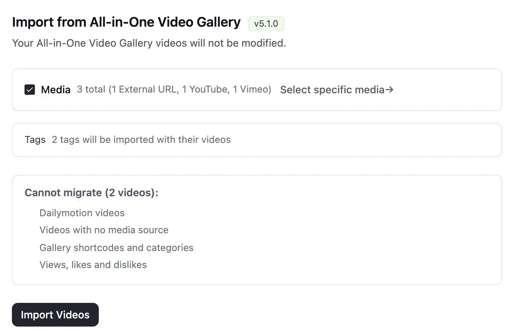
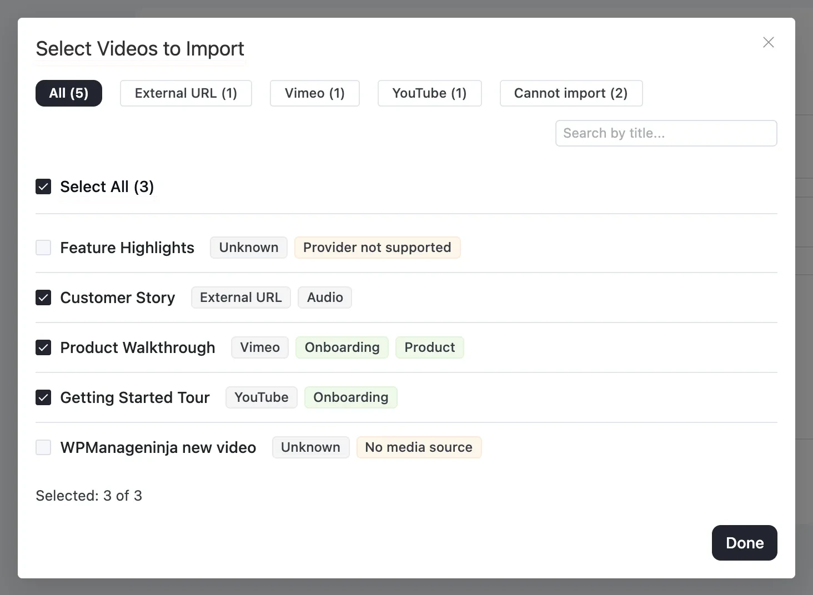
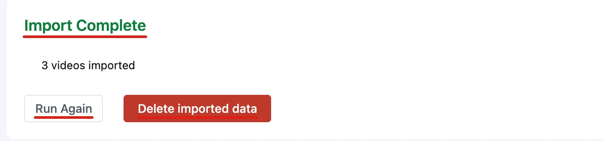
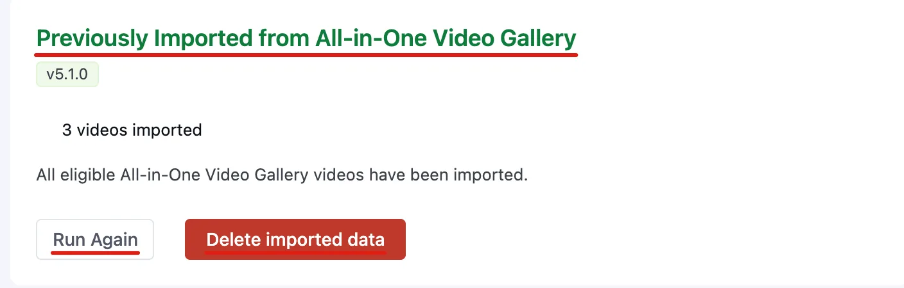

# Import from All-in-One Video Gallery

Already using **All-in-One Video Gallery**? FluentPlayer includes a built-in importer that turns your existing videos and audio files into FluentPlayer media in a few clicks, so you don't have to add them again one by one.

The import is one-way: it copies videos *from* All-in-One Video Gallery *into* FluentPlayer. Your All-in-One Video Gallery videos are only read, never changed, so you can keep both plugins active while you review the result.

::: info Free and Pro
The importer is included in the free plugin, and importing media works in Free. Importing **video tags** requires **FluentPlayer Pro**, because [media tags](/media-tags) are a Pro feature.
:::

## Requirements

- **FluentPlayer is installed and active.** See [Installation](/installation) if you still need to set it up. To bring your video tags across, also activate FluentPlayer Pro.
- **Your All-in-One Video Gallery videos are still on the site.** FluentPlayer reads them straight from your database. Keep All-in-One Video Gallery installed and active until you have finished importing and checked the result.

## What's Imported

Each All-in-One Video Gallery video becomes a new FluentPlayer media item. FluentPlayer brings across:

| What | Details |
|------|---------|
| **Title** | The video's title |
| **Status** | Published, draft, private and scheduled videos keep their status. Password-protected videos keep their password |
| **Source** | The video's playback source — see the table below |
| **Poster** | The poster image. If the poster is a Media Library image, it is also set as the media's featured image |
| **Duration** | The video length, when All-in-One Video Gallery knows it |
| **Audio** | Audio files (such as `.mp3`, `.m4a`, `.wav` or `.ogg`) are imported as audio media, not video |
| **Video tags (Pro)** | Each video's tags, added as FluentPlayer [media tags](/media-tags). Tags that don't exist yet are created |

Imported media use the **Default** preset. YouTube and Vimeo videos get a **16:9** aspect ratio so they display correctly.

### Supported Sources

| All-in-One Video Gallery source | Imported as |
|-----------------------------|-------------|
| Self-hosted file in your Media Library | Media Library video or audio |
| File URL from another server (MP4, WebM, OGV, HLS and similar) | External URL |
| YouTube | YouTube |
| Vimeo | Vimeo |
| Bunny Stream | Bunny Stream |

If a video has several sources (for example different qualities), FluentPlayer keeps the best one: a Media Library file first, then the highest quality.

If a video has no file in its source fields but has a video or audio added straight into its description, FluentPlayer imports that one instead.

::: warning Bunny Stream videos
All-in-One Video Gallery only stores each Bunny video's ID. To play imported Bunny media, add your Bunny API keys under **Settings → Storage**. See [BunnyCDN Stream](/bunnycdn-stream).
:::

## What's Not Imported

A few things can't be imported. The importer lists the ones that apply to your site under **Cannot migrate**, so you know what will be left behind:

- **Dailymotion videos**, **Rumble videos**, **Facebook videos** and **Embed-code videos**
- **Videos with no media source**
- **Video tags (requires FluentPlayer Pro)** — shown only on the free plugin when your videos have tags
- **Gallery shortcodes and categories**
- **Views, likes and dislikes**

The importer also doesn't change your posts and pages. Any All-in-One Video Gallery shortcodes or blocks on your pages stay as they are. Replace them with a FluentPlayer [block](/block) or [shortcode](/shortcode) when you are ready.

## How to Import

### Step 1: Open Migration

1. In your WordPress admin, go to **FluentPlayer** and open **Settings** (the gear icon).
2. In the settings sidebar, click **Migration**.

FluentPlayer detects your All-in-One Video Gallery videos and shows the **Import from All-in-One Video Gallery** screen, with the detected plugin version and the note *"Your All-in-One Video Gallery videos will not be modified."*

If you also use Presto Player, the screen shows one tab per plugin at the top. Click **All-in-One Video Gallery** to switch to it. See [Migrate from Presto Player](/presto-player-migration) for the other tab.

### Step 2: Choose Videos

The **Media** option is ticked by default and shows how many videos FluentPlayer found. If your videos have tags, a **Tags** row shows how many were found:

- With FluentPlayer Pro: *"tags will be imported with their videos"*.
- On the free plugin: *"tags found — importing them requires FluentPlayer Pro"*.

To import only some videos, click **Select specific media →**. The **Select Videos to Import** dialog lists every video. You can:

- Filter by source. The buttons show only the sources found in your library, each with a count (for example **All**, **External URL**, **YouTube** or **Vimeo**), plus **Cannot import** for videos that can't be brought across
- Search by title
- Use **Select All**, or tick individual videos

Videos that can't be imported are marked, for example **Provider not supported** or **No media source**. Videos you already imported are marked **Imported**. Click **Done** when your selection looks right.

::: info Large libraries
The importer shows up to the 5,000 newest videos that are still to import. If you have more, import these first, then use **Run Again** to reach the older ones.
:::

### Step 3: Run the Import

1. Click **Import Videos**.
2. A confirmation asks **Import N videos?** and explains: *"This creates N new FluentPlayer media. Your All-in-One Video Gallery videos are not modified."*
3. Click **Import**.

FluentPlayer shows a progress bar while it works. When it finishes, you'll see **Import Complete** with the number of videos imported and skipped. If some videos failed, the heading reads **Import Finished With Errors** and lists each skipped video with the reason.

## Import Again

After an import, the Migration tab shows a **Previously Imported from All-in-One Video Gallery** summary with the number of videos imported. If new videos have been added since, it tells you how many are available to import.

- **Run Again** lets you import new or skipped videos — for example after you activate FluentPlayer Pro to bring your tags across.
- **Re-import items already imported** appears on the import screen when some videos were already imported. Tick it to refresh their source URL, poster and duration from All-in-One Video Gallery. Your own edits in FluentPlayer, such as branding, overlays and chapters, are kept.

FluentPlayer remembers which video each media item came from, so running the import again never creates duplicates.

## Undo the Import

To remove everything the importer created, click **Delete imported data**. A confirmation explains: *"This deletes every media imported from All-in-One Video Gallery. Your original videos are not touched."* Click **Delete** to confirm.

::: warning
The imported media items are deleted permanently, not moved to the trash. This also removes any changes you made to those media items in FluentPlayer. Pages where you already embedded an imported media item will no longer show it.
:::

## Next Steps

- Review your imported videos under **FluentPlayer → Media**. See [Adding and Editing Videos](/adding-videos) to fine-tune each one.
- If you imported Bunny Stream videos, add your Bunny API keys under **Settings → Storage**.
- Pick a different [preset](/presets) or add [branding](/branding) to give your imported videos a new look.
- Replace All-in-One Video Gallery shortcodes on your pages with FluentPlayer [blocks](/block) or [shortcodes](/shortcode).

::: tip Take your time
Because the importer never touches your All-in-One Video Gallery videos, there's no rush to remove the old plugin. Keep both active, check everything in FluentPlayer, and switch over on your own schedule.
:::
