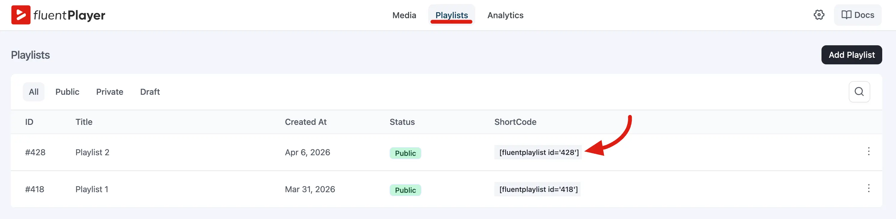
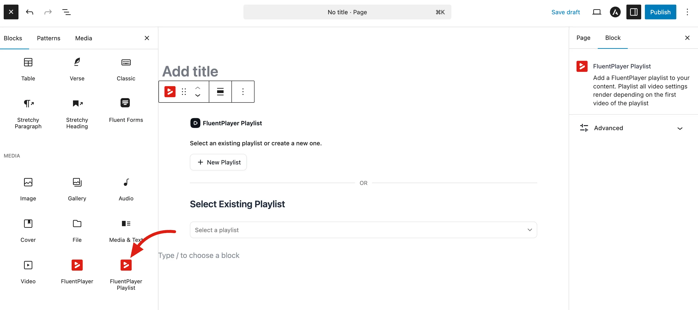
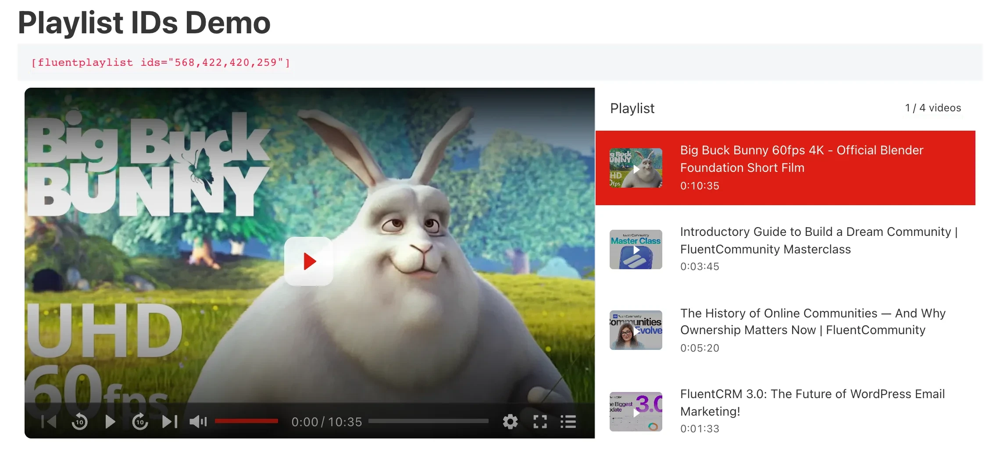
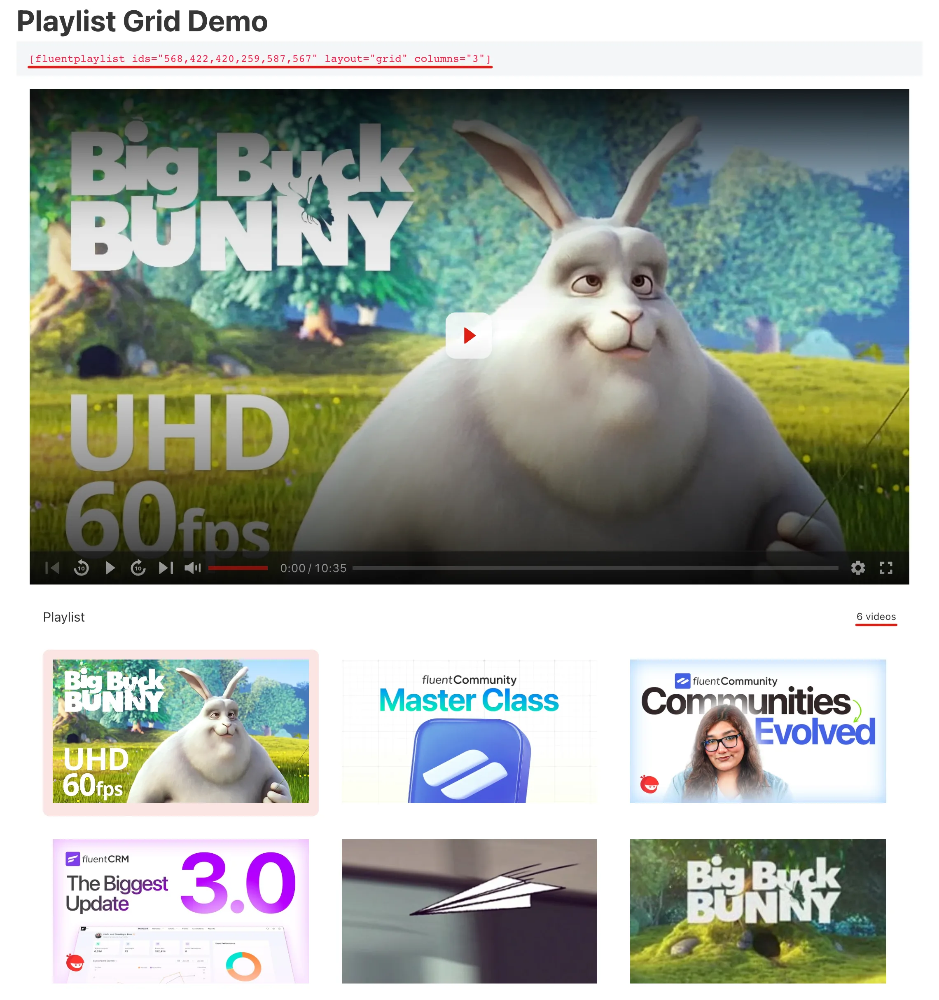

# Embed a Playlist

Once you have [created a playlist](/creating-playlists), you can show it on any post or page using a **shortcode** or a **Gutenberg block**. The process is very similar to [embedding a single video](/shortcode).

::: info Pro feature
Embedding playlists requires **FluentPlayer Pro**.
:::

## Option 1: Shortcode

Add this shortcode to any post or page:

```
[fluentplaylist id="10"]
```

Replace `10` with your playlist ID. The playlist will appear where you placed the shortcode.

### Where to find the playlist ID

- In **FluentPlayer → Playlists**, the ID appears next to each playlist (for example, `#10`).
- When editing a playlist, check the browser URL.



### Step by Step

**In the Classic Editor:**
1. Edit a post or page.
2. Type `[fluentplaylist id="10"]` where you want the playlist.
3. Publish or update.

**In the Block Editor (Gutenberg):**
1. Add a **Shortcode** block.
2. Type `[fluentplaylist id="10"]`.
3. Publish or update.

**In a theme template (PHP):**
```php
<?php echo do_shortcode('[fluentplaylist id="10"]'); ?>
```

## Option 2: Gutenberg block

1. Edit a post or page in the block editor.
2. Click the **+** button to add a block.
3. Search for **"FluentPlayer Playlist"** or **"playlist"**.
4. Select the block and choose your playlist from the dropdown (or enter the ID).
5. Publish or update.

The block shows a preview in the editor and renders the same output as the shortcode on the front end.



## Option 3: Bricks Builder

If you build pages with Bricks, add the **Fluent Player Playlist** element and pick your playlist. See [Bricks](/bricks) for the full steps.

## Build a Playlist From Media IDs

You don't have to save a playlist first. List the media IDs you want in the `ids` attribute, separated by commas:

```
[fluentplaylist ids="12,45,7"]
```

The videos play in the order you list them. By default the shortcode shows up to 20 videos. Use `limit` to change that, up to a maximum of 100:

```
[fluentplaylist ids="12,45,7,30,18" limit="3"]
```



Only videos that a visitor is allowed to watch are shown. Private and password-protected videos stay hidden, the same as in a saved playlist.

::: tip
To build a playlist from media tags instead of IDs, see [Tag-Based Playlists](/tag-based-playlists).
:::

## Change the Look From the Shortcode

You can override a playlist's layout and behavior right in the shortcode, without changing the saved playlist. These attributes work with `id`, `ids` and `tags`:

| Attribute | What it does | Values |
|-----------|--------------|--------|
| `layout` | Picks the [playlist layout](/playlist-layouts) | `standard` or `grid` |
| `columns` | Number of columns in the Grid layout | `2` to `6` |
| `autoplay` | Starts playing when the page loads | `1` or `0` |
| `continuous_play` | Plays the next video when one ends | `1` or `0` |
| `loop` | Starts over after the last video | `1` or `0` |
| `show_thumbnails` | Shows video thumbnails in the list | `1` or `0` |
| `search` | Shows the search box in the Grid layout | `1` or `0` |
| `filters` | Shows the filters in the Grid layout | `1` or `0` |

For the on/off attributes, `1`, `true`, `yes` and `on` turn the option on. Any other value, such as `0`, turns it off. Leave an attribute out to keep the playlist's own setting.

**Examples:**

```
[fluentplaylist id="10" layout="grid" columns="4"]

[fluentplaylist ids="12,45,7" autoplay="0" loop="1"]
```



## Share and Embed a Playlist on Other Websites

You can add a **Share** button to a playlist so viewers can copy an embed code or share it on social media. Turn on **Allow Sharing & Embedding** in the playlist's settings. See [Sharing & Embedding](/sharing-and-embedding#sharing-and-embedding-playlists-pro) for the details.

## What the Front End Looks Like

Depending on the [layout](/playlist-layouts) you chose for the playlist:

- **Standard** — A player with a video list on the side.
- **Grid** — A multi-column video grid.

The playlist loads all the media items you added, in the order you set. Viewers can click between videos, and the player handles transitions smoothly.

## Common Questions

**Can I put multiple playlists on the same page?**

Yes. Use separate shortcodes or blocks:

```
[fluentplaylist id="10"]

[fluentplaylist id="15"]
```

You can also place the same playlist more than once on a page. Each copy works on its own.

**What happens if I update the playlist later?**

Changes are immediate. If you add or remove a video from the playlist, every page that embeds it will show the updated list.

**Can I embed a playlist in a widget?**

Yes, as long as the widget supports shortcodes. Use `[fluentplaylist id="10"]` in a Text or Custom HTML widget.
