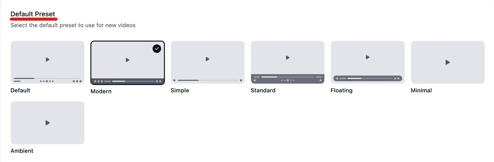
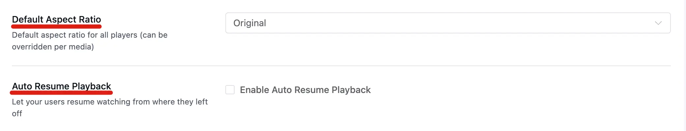
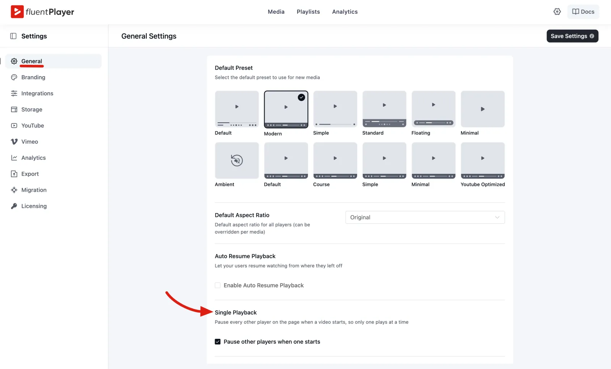
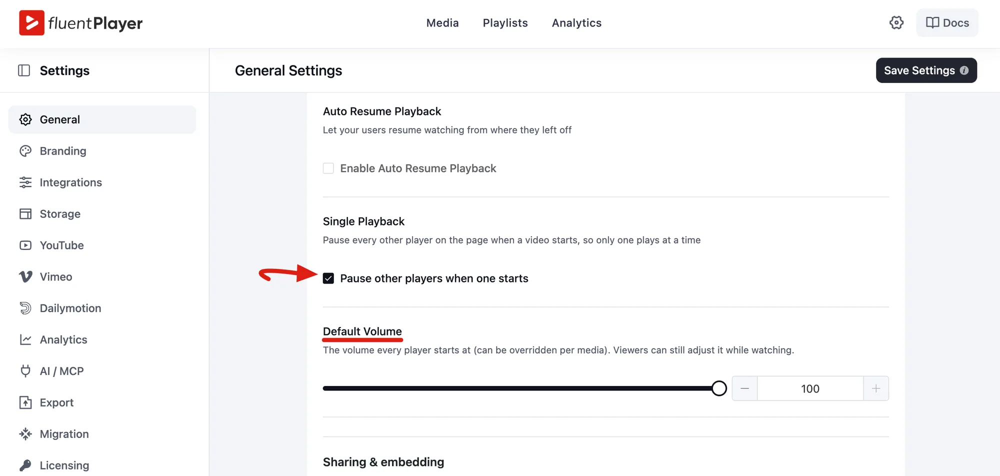
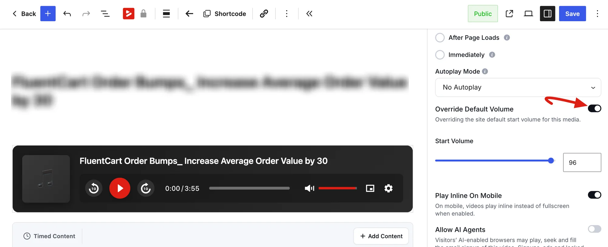

# General Settings

The **General** section under **Fluent Player → Settings** sets site wide defaults for every player on your site. Use it to choose the default preset and aspect ratio, enable resume playback (Pro), and add global custom CSS (Pro). These values apply everywhere unless a [preset](/presets) or a per media setting overrides them.

To open it, go to **Fluent Player → Settings** and select **General** from the inner settings sidebar. See [Settings Overview](/settings) for how global settings relate to presets and per media overrides.

## Default Preset

The preset grid shows every available player skin. The selected preset has a checkmark and a highlighted border. That choice becomes the default look and behavior for new media items that do not pick a different preset.

| Preset | Character |
|--------|-----------|
| **Default** | Balanced layout with standard controls |
| **Modern** | Rounded corners and floating controls |
| **Simple** | Minimal UI, clean and distraction free |
| **Standard** | Classic control bar layout |
| **Floating** | Control bar floats over the video |
| **Minimal** | Bare bones controls |
| **Ambient** (Pro) | Muted autoplay, hidden controls, loop on end — tuned for background video |



::: tip
Changing the default preset does **not** update media that already has an explicit preset assigned. It applies to new media and to items with no preset override.
:::

You can create additional skins with [custom presets](/creating-custom-presets) (Pro) and set one of those as the site default here.

## Default Aspect Ratio

Use the **Default Aspect Ratio** dropdown to set how players size themselves site wide. Common options include **Original**, **16:9**, and **4:3**.

Individual media items and block embeds can override this under **Block** tab → **General Settings** when a specific video needs a different ratio.

## Auto Resume Playback (Pro)

**Checkbox:** Enable Auto Resume Playback — *"Let your users resume watching from where they left off."*

When this global toggle is on, FluentPlayer Pro stores playback position in the viewer's browser. The next time they open the page with that video, it starts from where they stopped.



Resume playback works at three levels. All relevant toggles should be on for a given embed:

| Level | Where to enable |
|-------|-----------------|
| **Global** | **Settings → General** → **Enable Auto Resume Playback** |
| **Preset** | **Save play position** in the preset’s [behaviors](/behaviors) |
| **Per embed** | **Block** tab → **General Settings** → **Remember Playback Position** |

::: info
The global toggle in Settings and the per embed **Remember Playback Position** control work together. Enable both (plus the preset behavior when you use presets) so resume works as expected on a specific video.
:::

::: tip
Playback position is stored in the viewer’s browser. It does not carry over to another device or browser, and clearing site data will reset it.
:::

## Single Playback

**Checkbox:** Pause other players when one starts — *"Pause every other player on the page when a video starts, so only one plays at a time."*

When a page has more than one FluentPlayer video on it, starting one video pauses all the others. Viewers never end up with two soundtracks playing over each other. It matters most on media libraries, lesson pages, and article layouts, where several videos can sit close together on the same page.

**This is on by default**, and it's a free feature. Most sites should leave it alone.

You'll find it at the bottom of the General panel, just below **Auto Resume Playback**.



**When to turn it off:** if you deliberately want players to run at the same time — for example a muted background video that should keep looping while a viewer watches a different video on the same page.

::: tip Ambient and background video
If you use the **Ambient** preset for a decorative background video, consider turning Single Playback off. Otherwise starting any other video on the page will pause your background loop.
:::

## Default Volume

**Slider:** Default Volume — *"The volume every player starts at (can be overridden per media). Viewers can still adjust it while watching."*

Use this to set the starting volume for all your players, so viewers aren't surprised by a video that is too loud or too quiet. The slider goes from 0 to 100, and you can also type a number in the box next to it. The default is **100**, which is full volume.

To change it, go to **Fluent Player → Settings → General** and scroll down to **Default Volume**, just below **Single Playback**. Drag the slider or enter a value, then click **Save Settings**.



**Set a different volume for one video:** open the media, go to **General Settings**, and switch on **Override Default Volume**. Then set its own **Start Volume**. With the switch off, the video follows the site default.

::: tip
Viewers can still change the volume while watching. Your default only sets where the player starts.
:::



## Custom CSS (Pro)

A text area for global CSS that applies to every FluentPlayer instance on your site. The UI suggests scoping your rules:

```css
.fluent-player {
  /* your overrides here */
}
```

Use this for small tweaks that presets do not cover — for example, progress bar height or tooltip colors. For larger visual changes, edit or create a [preset](/presets) instead of relying on global CSS alone.

If the player looks broken after a theme update, check for CSS conflicts here and in your theme before changing other settings. See [Common Issues & Fixes](/troubleshooting) for troubleshooting tips.

## Saving Changes

Click **Save Settings** in the top right of the General panel after you make changes. New page loads will use the updated defaults immediately.

Per media and block overrides still take priority. If a video does not reflect a global change, open that media item and confirm it is not overriding the setting at the preset or block level.
