# AI / MCP

With FluentPlayer, you can connect your video library to AI tools like **Claude Code**, **Claude Desktop**, **Cursor**, **VS Code** and **Codex** using **MCP** (Model Context Protocol). Once connected, you can ask your AI assistant to list your videos, create a player from a YouTube link, apply a preset or check your media for accessibility problems, all in plain language.

Every connection signs in with a **WordPress application password**. Your AI assistant only ever has the same permissions as the WordPress user it signs in as. It never gets more access than that account already has.

::: info MCP vs WebMCP
MCP on this page is for **you**, the site owner, working from an AI app. **WebMCP** is a separate feature that lets your **visitors'** AI browsers control a player on your site. See [WebMCP](#webmcp-let-visitors-ai-browsers-control-a-player) at the end of this page.
:::

## Open the MCP Settings

Go to **FluentPlayer → Settings** and select **AI / MCP** from the settings sidebar.

Here you will find everything you need to turn MCP on, install the required plugin, and copy the setup code for your AI client.

::: info
Only administrators can open the **AI / MCP** screen and change these settings.
:::

## Step 1: Enable MCP

Turn on **Enable MCP** at the top of the page. Once it is on, FluentPlayer makes its tools available to authorized AI clients.

The help text under the switch reads: *"Let AI assistants like Claude, Cursor and VS Code manage your media, presets and analytics. Signed-in users who can manage media connect with an application password."*

::: tip
If you ever want to stop every connected AI tool from reaching FluentPlayer, turn **Enable MCP** off. While it is off, the endpoint refuses every request. Your other settings stay unchanged.
:::

If FluentHub is active, you will also see *"FluentHub is active, so this switch also appears on its MCP page."* with an **Open FluentHub** link. You can turn MCP on or off from either place.

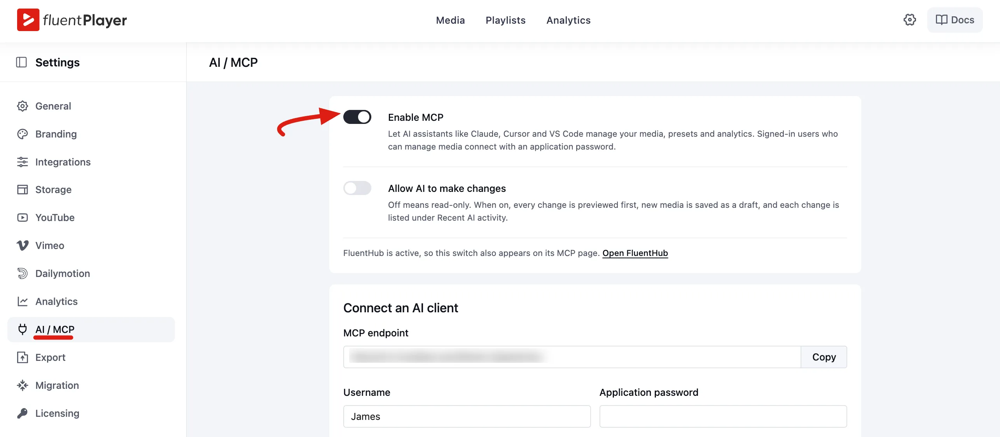


### Allow AI to Make Changes

The second switch, **Allow AI to make changes**, decides whether the AI can only read your data or can also change it. It is **off** by default.

- **Off:** read-only. The AI can look at your media, presets and settings, but the tools that change things are not offered to it at all.
- **On:** the AI can also make changes. As the help text explains, *"every change is previewed first, new media is saved as a draft, and each change is listed under Recent AI activity."*

Before any change is saved, the AI first gets a preview of what would happen and must confirm it with a short-lived code. Most AI clients show you this preview and ask you to approve it.

::: tip
Start with **Allow AI to make changes** turned off. Let the AI read your library first, and turn on changes only when you are ready.
:::

## Step 2: Install and Activate FluentHub

FluentPlayer uses a lightweight companion plugin called **FluentHub** to power the connection. You also need **WordPress 6.9 or newer**. On older versions the screen shows *"MCP needs WordPress 6.9 or newer. Update WordPress to use it."*

Until FluentHub (or the MCP Adapter plugin) is active, the screen shows *"Install FluentHub (or the MCP Adapter plugin) so AI clients can connect."* with a button to fix it:

- **Install FluentHub:** one-click install. WordPress downloads, installs and activates it for you. With FluentPlayer Pro, this works for users who can install and activate plugins.
- **Activate FluentHub on the Plugins page:** shown when FluentHub is installed but not active.
- **Download FluentHub:** shown otherwise. Download it, install it from **Plugins → Add New**, then reload the page.

::: tip Prefer to install it yourself?
Download FluentHub directly from [static.wpmanageninja.com/fluent-toolkit.zip](https://static.wpmanageninja.com/fluent-toolkit.zip), then upload the ZIP via **Plugins → Add New → Upload Plugin** and activate it. Come back to this page afterwards and the endpoint fields appear.
:::

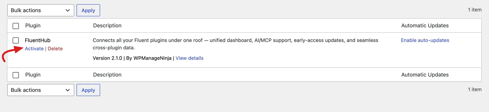

## Step 3: Create an Application Password

AI clients sign in to FluentPlayer with a **WordPress application password**, not your regular login password. You can revoke an application password at any time without changing your main password.

1. In the **Connect an AI client** section, click **Create an application password**. You can also go to **Users → Profile** and scroll down to **Application Passwords**.
2. In **New Application Password Name**, enter a name that tells you where it's used, such as **Cursor** or **Claude Code on my laptop**. Use one password per device or app.
3. Click **Add Application Password**.

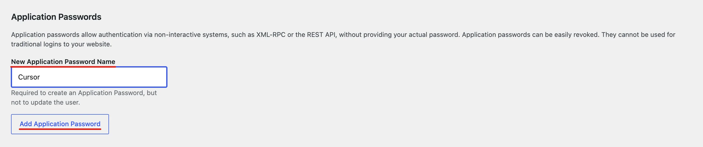

4. Click **Copy** next to your new password and keep it somewhere safe.

::: warning
The password is shown only once. If you lose it, revoke that entry and create a new one.
:::

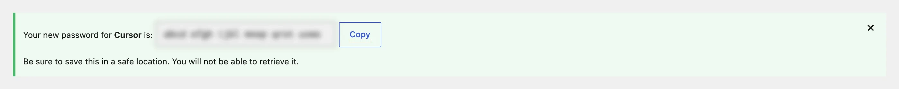


## Step 4: Fill In Your Details

Go back to **FluentPlayer → Settings → AI / MCP**. Once MCP is enabled, a **Connect an AI client** section appears.

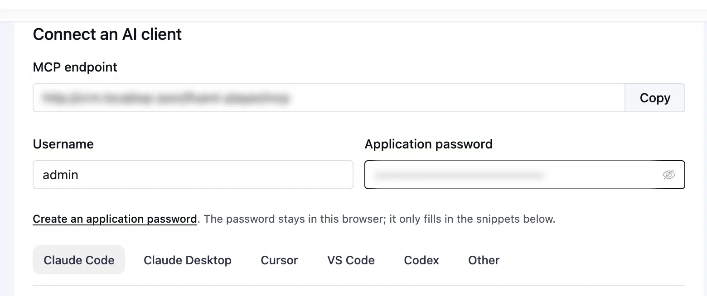

| Field | What it is |
|-------|-----------|
| **MCP endpoint** | The address your AI client connects to, such as `https://your-site.com/wp-json/fluent-player/mcp`. Click **Copy** to grab it. |
| **Username** | Filled in with your own WordPress login. |
| **Application password** | Paste the password from Step 3. |

As the screen says, *"The password stays in this browser; it only fills in the snippets below."* FluentPlayer doesn't save it. Once both fields are filled in, the setup code on every client tab already includes your login, so you can copy it as it is.

::: warning Treat the setup code like a password
Once you fill in the application password, the copied setup code contains your login details. Never paste it into public repositories, chats or shared screenshots.
:::

### Before You Connect: Check for Node.js

**Claude Desktop** connects through a small helper tool that runs with **Node.js**. Claude Code, Cursor, VS Code and Codex connect directly and don't need it.

To check, open **Terminal** (Mac) or **Command Prompt** (Windows) and run:

```
node -v
```

If a version number appears, you're all set. If the command isn't recognized, download the **LTS** version from [nodejs.org](https://nodejs.org/), run the installer, then fully quit and reopen Claude Desktop.

## Step 5: Connect Your AI Client

Under the fields, pick the tab for your AI client: **Claude Code**, **Claude Desktop**, **Cursor**, **VS Code**, **Codex** or **Other**. Each tab shows a short instruction, the setup code, and a **Copy** button.

The setup code and where you paste it are different for each client, so follow the section for yours.

### Connecting Claude Code

1. **Copy the setup code.** Select the **Claude Code** tab and click **Copy**.

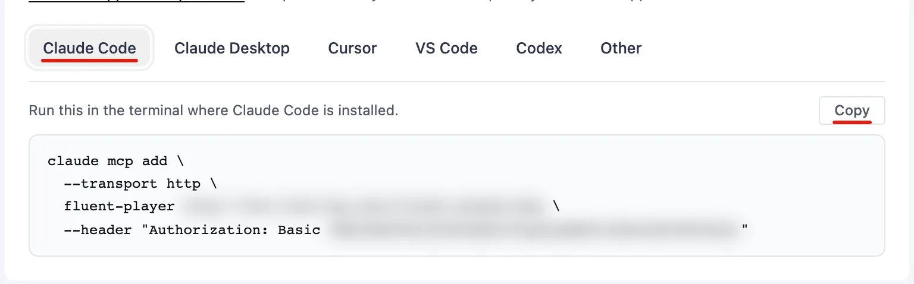

2. **Run it in your terminal.** Paste the command into the terminal where Claude Code is installed and press Enter. Claude Code confirms that it added the `fluent-player` server.

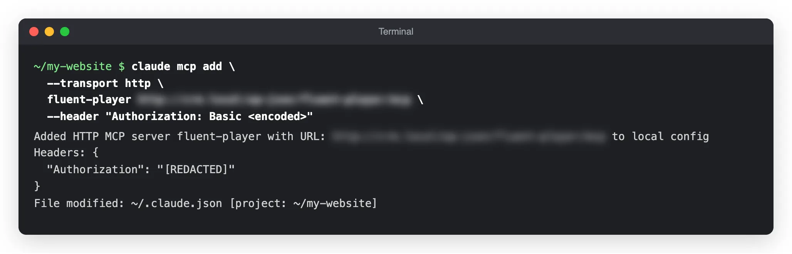

3. **Check the connection.** Run `claude mcp get fluent-player`. You should see **Status: ✔ Connected**. Inside Claude Code you can also type `/mcp` to see it in your server list.

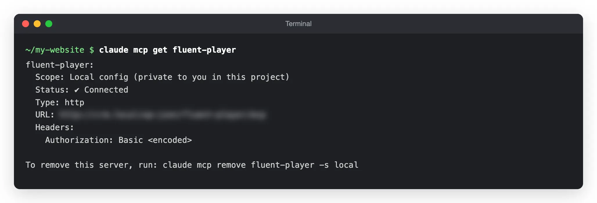

4. **Try an example.** Ask Claude Code something simple, such as *"List my 5 newest Fluent Player media items with their ID, title, provider and shortcode."* Claude Code calls FluentPlayer and replies with your videos.

::: tip
Claude Code adds the server to the folder you ran the command in. Run the command from the folder you usually work in, or add `--scope user` after `claude mcp add` to make it available everywhere.
:::


### Connecting Claude Desktop

Claude Desktop reads its MCP servers from a configuration file. It connects through a helper that runs with Node.js, so check [Node.js](#before-you-connect-check-for-node-js) first.

1. Select the **Claude Desktop** tab in FluentPlayer and click **Copy**.

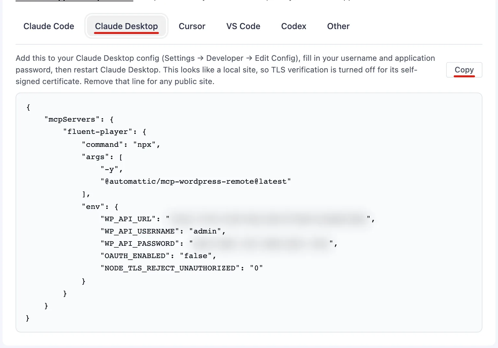

2. In Claude Desktop, go to **Settings → Developer → Edit Config**. Claude Desktop opens the folder with its configuration file, `claude_desktop_config.json`:
   - **macOS:** `~/Library/Application Support/Claude/claude_desktop_config.json`
   - **Windows:** `%APPDATA%\Claude\claude_desktop_config.json`
3. Open the file in a plain text editor (TextEdit or Notepad), paste the code, and save. If the file already lists other servers, add the `fluent-player` entry inside the existing `mcpServers` block so the file stays valid JSON.
4. Fully quit Claude Desktop and open it again. Closing the window isn't enough. Quit it from the menu bar (macOS) or the system tray (Windows).

<!-- SCREENSHOT: /docs/public/settings/mcp/claude-desktop-connected-21.webp — Claude Desktop showing fluent-player as a connected MCP server -->

::: info Local sites
On a local test site (for example a `.local` or `.test` address), the Claude Desktop code turns off certificate checks so it works with a self-signed certificate. Remove the `NODE_TLS_REJECT_UNAUTHORIZED` line for any public site.
:::

### Connecting Cursor

1. Select the **Cursor** tab in FluentPlayer and click **Copy**.

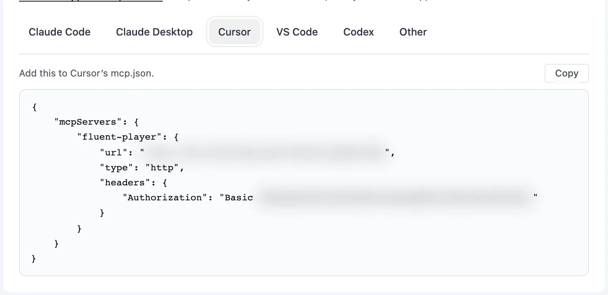

2. In Cursor, open **Cursor Settings** and go to **Tools & MCP**. Click **New MCP Server**. Cursor opens its `mcp.json` file.
3. Paste the code and save. If the file already has servers, add the `fluent-player` entry inside the existing `mcpServers` block.a
4. Back in **Tools & MCP**, turn on **fluent-player** if Cursor asks you to approve it. Its tools are listed underneath.

<!-- SCREENSHOT: /docs/public/settings/mcp/cursor-tools-mcp-22.webp — Cursor Settings → Tools & MCP with fluent-player enabled and its tools listed -->

If you use Cursor's command-line agent, you can check the connection with `cursor-agent mcp list-tools fluent-player`:

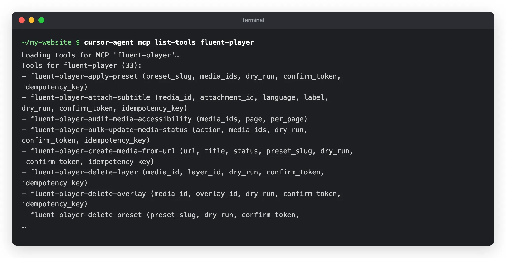

### Connecting VS Code

1. Select the **VS Code** tab in FluentPlayer and click **Copy**.

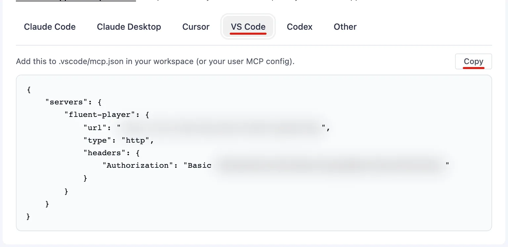

2. In VS Code, open the Command Palette and run **MCP: Open User Configuration**. You can also create a `.vscode/mcp.json` file in your project.
3. Paste the code into the file and save it.
4. Start the `fluent-player` server from the MCP view in VS Code.

<!-- SCREENSHOT: /docs/public/settings/mcp/vscode-mcp-23.webp — VS Code with fluent-player running in the MCP servers view -->

### Connecting Codex

Select the **Codex** tab in FluentPlayer. Instead of a file to paste, it lists the details to enter:

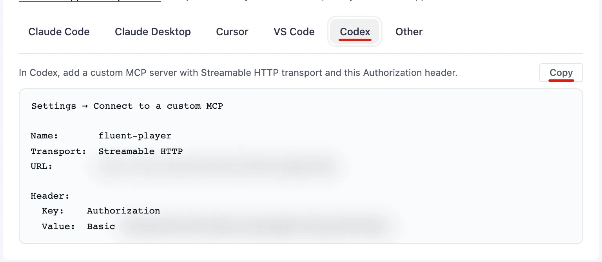

In Codex, go to **Settings → Connect to a custom MCP** and fill in:

- **Name:** `fluent-player`
- **Transport:** **Streamable HTTP**
- **URL:** your **MCP endpoint**
- **Header:** key `Authorization`, with the `Basic …` value from the tab

Save it, and Codex is ready to use FluentPlayer.

### Connecting Other MCP Clients

If you use another AI app that supports MCP, select the **Other** tab. Use the **Streamable HTTP** transport with the URL and `Authorization` header it shows.

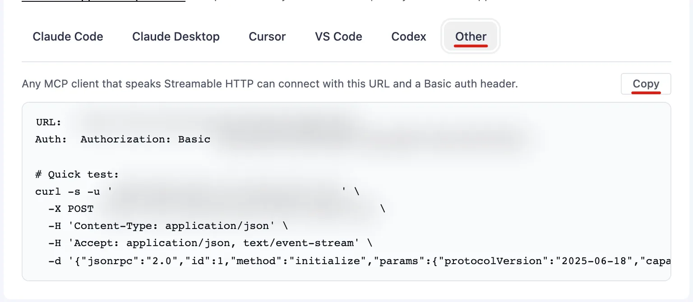

Want to test the connection first? Copy the **Quick test** command and run it in your terminal. If it works, FluentPlayer answers with its server details.

## Step 6: Verify It's Working

Open your AI client and ask it to do something real. With **Allow AI to make changes** on, try creating a player:

*"Create a draft Fluent Player media from https://www.youtube.com/watch?v=aqz-KE-bpKQ titled 'MCP Demo Video'. Preview it first, then confirm."*

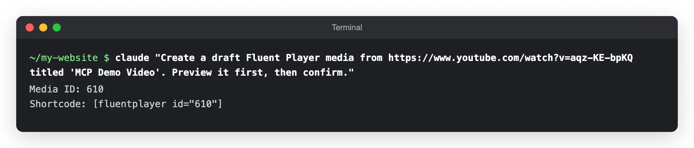

Now open **FluentPlayer → Media**. The new player is in your **Media List**, saved as a **Draft** so nothing goes live until you publish it.

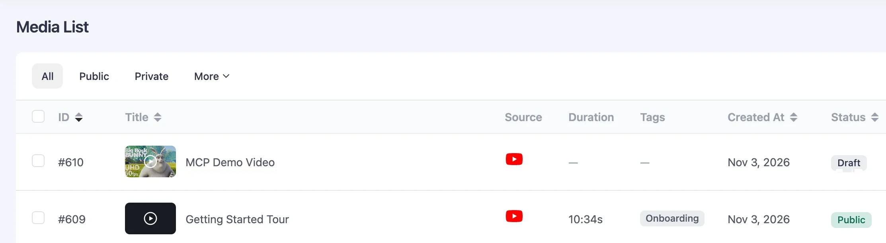

### Recent AI Activity

Every change made through MCP is listed in the **Recent AI activity** table on the **AI / MCP** page, with **When**, **User**, **Tool** and **Target** columns. If nothing has changed yet, it shows *"No AI changes yet."* FluentPlayer keeps the latest 200 entries.

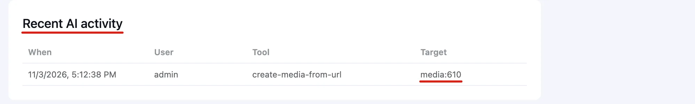

## What Your AI Assistant Can Do

Once connected, you don't need to remember any technical names. Just describe what you want, and your AI assistant picks the right tool.

### Media

- List your videos and audio, or look at one item's full settings.
- Create a player from a YouTube, Vimeo or direct media link (saved as a draft).
- Change media settings, or publish, unpublish, trash and restore up to 50 items at once.
- Save chapters for a video.

Try asking: *"List my draft videos."* or *"Add chapters to video 568 at 0:00 Intro, 1:30 Setup and 4:00 Results."*

### Look and Engagement

- List presets and apply one to up to 50 media items.
- Add, edit or delete overlays and layers.
- Match the player colours to your site.
- Read the emails collected by email capture forms.

Try asking: *"Apply the Modern preset to all my YouTube videos."* or *"Match the player to my site colours."*

### Analytics, Playlists and Captions (Pro)

- See your views, top videos, one video's views per day, or where viewers drop off.
- List and save playlists.
- Attach caption files, or import captions from YouTube and Vimeo.
- Tag media, and save or delete custom presets.

Try asking: *"Show my top 3 videos this month."* or *"Find where viewers drop off in video 568 and suggest a CTA."*

### Tools

The **Tools** section lists every tool, shows how many are available to AI clients right now, and lists the ready-made prompts. Each tool has a tag:

- **Read:** looks at data only.
- **Write:** changes data.
- **Destructive:** changes or removes data in a way that is hard to undo, such as replacing all chapters or moving media to the trash.
- **Pro:** needs FluentPlayer Pro.
- **Changes off:** a write tool that is hidden from the AI because **Allow AI to make changes** is off.

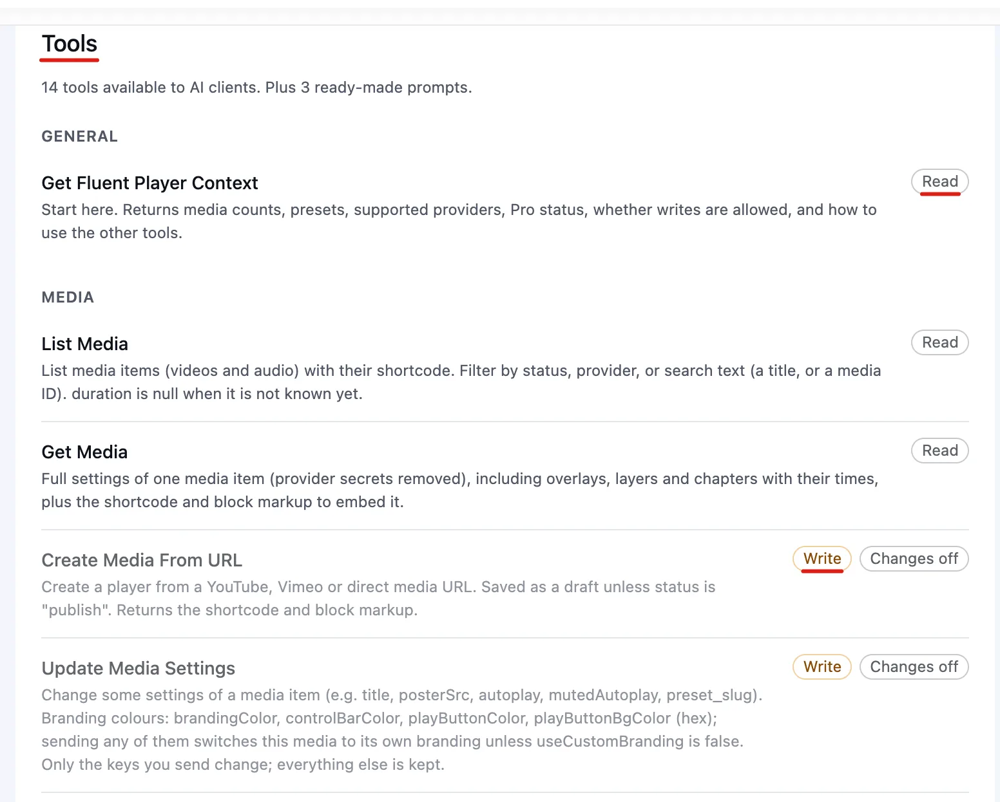

| Group | Free tools |
|-------|-------|
| **General** | **Get Fluent Player Context**: the starting point. Returns media counts, presets, supported sources, Pro status and whether changes are allowed |
| **Media** | **List Media**, **Get Media**, **Create Media From URL**, **Update Media Settings**, **Bulk Update Media Status** |
| **Chapters** | **Save Media Chapters**: replaces all chapters of one media item |
| **Presets** | **List Presets**, **Apply Preset** |
| **Engagement** | **Get Email Leads**: emails collected by email capture forms |
| **Overlays & Layers** | **Add or Edit Overlay**, **Delete Overlay**, **Add or Edit Layer**, **Delete Layer** |
| **Global Settings** | **Get Global Settings**, **Get Site Colors**, **Update Global Settings** |
| **Audit** | **Audit Media Accessibility**: checks for missing captions, autoplay with sound, missing titles and missing posters |

With **FluentPlayer Pro** active, these tools are added. On the free plugin they appear greyed out with a **Pro** tag.

| Group | Pro tools (Pro) |
|-------|-------|
| **Analytics** | **Get Analytics**: site overview, top videos, one video's views per day, or an estimated drop-off curve |
| **Playlists** | **List Playlists**, **Save Playlist** (new playlists are saved as drafts) |
| **Captions** | **List Captions**, **Attach Caption File**, **Remove Caption Track**, **List YouTube/Vimeo Captions**, **Import YouTube/Vimeo Captions** |
| **Timed Content** | **Get Timed Content**, **Set Timed Content** |
| **Tags** | **List Tags**, **Tag Media**, **Delete Tag** |
| **Presets** | **Save Preset**, **Delete Preset** (built-in presets can't be deleted) |

::: info
On the free plugin, the AI can save text overlays, but they only show on the player with FluentPlayer Pro. The **text CTA** and **hotspot** layer types need FluentPlayer Pro. Email provider settings are never read or changed through MCP.
:::

### Ready-Made Prompts

Some AI clients also show ready-made prompts from FluentPlayer. Each one only appears when all the tools it needs are available:

- **Audit my videos**
- **Find where viewers drop off and suggest a CTA** (uses Pro analytics)
- **Set up a new video from a URL**
- **Match the player to my site colours**

## Who Can Use It

The AI client acts as the WordPress user whose application password it uses. FluentPlayer checks that user on every request:

- The user must have FluentPlayer **authoring access**. By default, that means Editors and Administrators. See [Authoring Permissions](/capabilities) to change this.
- Some tools need administrator rights on top of that: **Get Email Leads**, **Get Global Settings**, **Get Site Colors**, **Update Global Settings**, and the Pro tools **Get Analytics**, **Save Preset**, **Delete Preset** and **Delete Tag**. An Editor's AI client can't use them.
- Email addresses returned by **Get Email Leads** are masked unless the AI asks for the full addresses, and that request is logged.

## Security, Revocation, and Best Practices

- **Separate passwords:** create one application password for each device or AI client. If you stop using one, you can revoke it without breaking the others.
- **Revoking access:** go to **Users → Profile → Application Passwords** and click **Revoke** next to that password. AI clients using it stop working right away.
- **Credential safety:** the setup code contains your login details. Treat it like a password and never share it publicly.
- **A dedicated user:** for the safest setup, create a separate WordPress user for your AI client with only the access it needs.
- **Reviewable by design:** every change is previewed before it is saved, new media and playlists are saved as drafts, and each change is listed in **Recent AI activity**.

## WebMCP: Let Visitors' AI Browsers Control a Player

**WebMCP** is a separate, newer standard for **your visitors**. Some AI-enabled web browsers can use tools that a web page offers. FluentPlayer can offer a few player tools to these browsers, so a visitor can ask their browser's AI to play, pause or skip to a chapter.

WebMCP is **off** for every video by default. You turn it on per video:

1. Open the video in the player editor.
2. Go to **Block** tab → **General Settings**.
3. Turn on **Allow AI Agents**.

The help text reads: *"Visitors' AI-enabled browsers may play, seek and fill the email signup of this video. Signups, ads and locked lessons still need the visitor."*

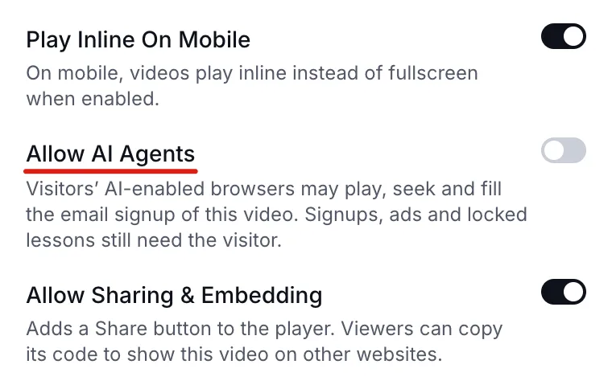

When it is on, a visitor's AI browser can:

- List the players and playlists on the page
- Play, pause, jump to a time, change volume and change speed
- List and jump to chapters, and list caption tracks
- Move through playlist items it is allowed to open
- Fill in the email field of an email capture form

The visitor stays in control. The AI fills in the email field, but the visitor presses the button to submit. Playback stops at any email capture, call to action or ad the visitor hasn't been through yet, and locked lessons can't be opened.


