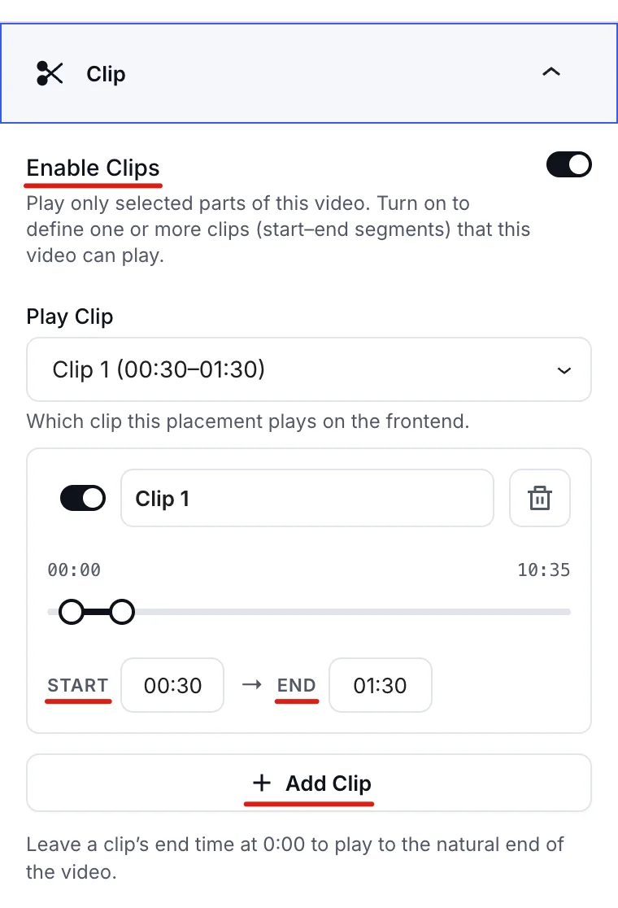
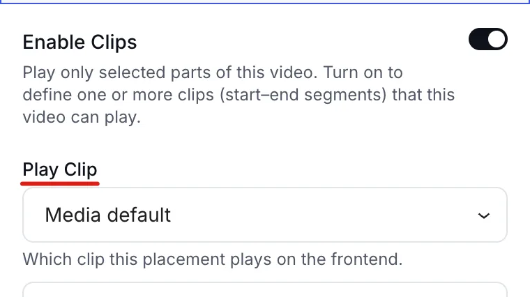
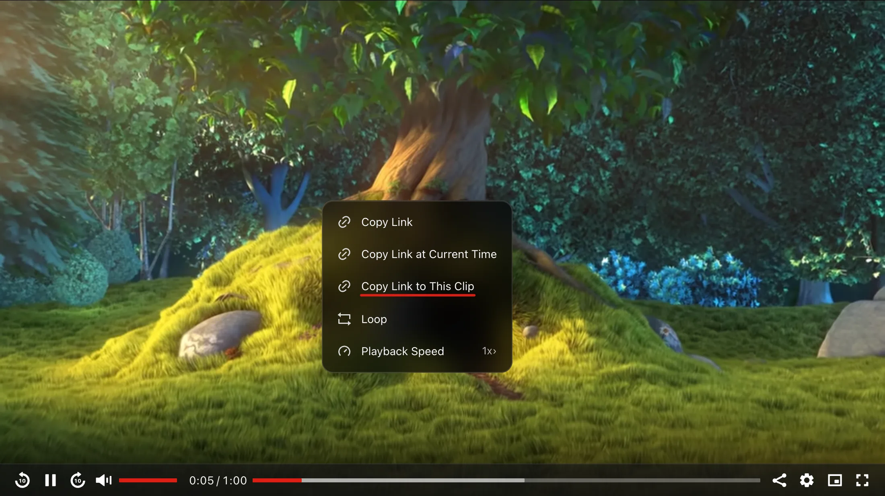

# Video Clips (Pro)

A **clip** is a part of a video with a start time and an end time. When a player uses a clip, it plays only that part, so you can show one highlight from a long recording without editing or uploading a new file.

::: info Pro feature
Video clips require **FluentPlayer Pro**. In the free version, the **Clip** panel shows an **Upgrade to Pro** button instead of the clip settings.
:::

## Why Use Clips?

- **Share a highlight.** Show the two minutes of a webinar that answer one question.
- **Reuse one video.** Put different parts of the same video on different pages.
- **Keep viewers focused.** Skip the intro or the closing talk.

## How Clips Work

Clips belong to the video, not to the page. You can add up to **50 clips** to one video. Each place you show that video then picks which clip to play, or plays the full video.

When a player plays a clip, it starts at the clip's start time and stops at its end time. The progress bar covers only the clip.

## Create a Clip

1. Open the video in the Player Editor, or select a **FluentPlayer** block on any page.
2. In the **Block** tab of the right sidebar, expand the **Clip** panel.
3. Turn on **Enable Clips**.
4. Click **Add Clip**. A new clip card appears, named **Clip 1**.
5. Type a name for the clip in the name field, or keep the default.
6. Set the **Start** and **End** times. You can drag the handles on the timeline, or type a time such as `1:30` and press <kbd>Enter</kbd>.
7. Save or update the page.



To add more clips, click **Add Clip** again. Each clip card has its own on/off toggle, so you can turn a clip off without deleting it. To remove a clip, click the delete icon on its card and confirm with **Delete**.

::: tip Play to the end
Leave a clip's **End** time at `0:00` to play from the start time to the natural end of the video.
:::

::: warning Changes apply everywhere
Because clips are saved on the video, editing or deleting a clip changes it on every page that shows the video.
:::

## Choose Which Clip a Player Plays

Once a video has at least one clip turned on, the **Clip** panel shows a **Play Clip** dropdown. It sets which clip this placement plays on your site. **Media default** is only offered when the video is placed in a block on a page or post, not in the video's own editor.

- **Media default**: plays the video's default clip (see below).
- **Full video**: ignores the clips and plays the whole video.
- **A clip by name**: plays that clip. Each option shows the clip's name followed by its start and end times.



### The default clip

The default clip is the one a video plays when a placement doesn't choose one:

- If you picked a clip in **Play Clip** inside the Player Editor, that clip is the default.
- If the video has only one clip turned on, that clip is the default.
- If the video has several clips and you haven't picked one, the full video plays.

In the Player Editor, the **Play Clip** dropdown has no **Media default** option, because you're setting the default there.

If a placement points to a clip that you later delete or turn off, it falls back to the default clip.

## Set a Clip in the Shortcode

You can also set a clip directly in the [shortcode](/shortcode) with the `start_clip` and `end_clip` attributes. They work with both `[fluentplayer]` and `[fluentmedia]`.

```text
[fluentplayer id="129" start_clip="1:30" end_clip="3:45"]
```

| Attribute | Description |
|-----------|-------------|
| `start_clip` | Where the clip starts. |
| `end_clip` | Where the clip ends. Leave it out to play to the end of the video. |

Both attributes accept seconds (`90`), minutes and seconds (`1:30`), or hours, minutes and seconds (`1:05:30`).

A few rules apply:

- The shortcode clip replaces any clip chosen for the video in the editor.
- If `end_clip` is not later than `start_clip`, the clip plays to the natural end of the video.
- If both values are empty or not valid times, the player uses the video's default clip.
- Times longer than one week are ignored.

::: tip Clip vs start time
The `start` attribute only sets where playback begins. Viewers can still seek back and watch the rest. Use `start_clip` and `end_clip` when you want the player to show only that part.
:::

## Share a Link to a Clip

Viewers can copy a link that opens the player on the same clip. Right-click the player while it plays a clip and choose **Copy Link to This Clip**.



This menu item appears only when:

- The player is playing a clip.
- The video is not a live stream.
- **Copy Link At Current Time** is turned on in the preset's [Context Menu](/creating-custom-presets#context-menu) settings.

The copied link is the page address with a few extra values added to the end:

```text
https://example.com/demo-page/?flp_r=<player>&flp_t=90&flp_e=225
```

- `flp_r` identifies which player on the page the link is for.
- `flp_t` is the start time in seconds.
- `flp_e` is the end time in seconds.

When someone opens the link, the page scrolls to that player and it plays only that part of the video. To send people to a single moment instead of a range, use **Copy Link At Current Time** or [timestamp links](/timestamp-links).

## Clips in Playlists

[Playlists](/playlists) respect clips. Each video in a playlist plays its own default clip. If a video has no clips turned on, or several clips with none picked as the default, the playlist plays the full video.

To control which part of a video a playlist plays, open that video in the Player Editor and pick a clip in **Play Clip**.

## Limits

- Up to **50 clips** per video.
- A clip's start time must be earlier than its end time.
- Clip links don't work for live streams.
- If a placement replaces the video's source (for example with the shortcode's `source_url` attribute), the editor's clip choice no longer applies, because it's a different video.
